# Mutation Caller - Plan

## Goal Capsule

- **Objective:** every push to `main` runs mutation testing on `@systemfsoftware/api-extractor`'s workflow and schema code, so a surviving mutant turns `main` red.
- **Means:** a thin caller of systemfsoftware's shared `reusable-mutation.yml`, pinned to the commit where unit O1 lets that workflow install the `.sfs-deps` tarballs (KTD1).
- **Product authority:** this plan, then `AGENTS.md`, then `docs/plans/2026-10-10-1146-feat-effect-api-extractor-plan.md`, whose KTD20 and its mutation Key Decision this plan carries out. The front-ends, resolver and phase profile that the 1146 plan's KTD1 put in PR3 are not active scope here.
- **Open blockers:** O1. systemfsoftware `main` (`feb68840`) has `reusable-mutation.yml` from #710 (`9154691`), but its mutation job installs with plain `pnpm install --frozen-lockfile` (`.github/actions/install-deps`) and takes no input that could place `.sfs-deps/` first. This lockfile names `file:.sfs-deps/*.tgz`, so that install fails here. The O1 rev is `<O1-rev>` until it lands.
- **Open question for the root:** at `feb68840` the shared run concludes `success` when a package scores below its break threshold, so the shared workflow alone does not yet turn `main` red on a survivor (Dependencies / Assumptions). PR3 delivers the caller and a graded proof either way; whether the red signal comes from O1 or another systemfsoftware unit is the root's call (Outstanding Questions).
- **Execution profile:** PR3 on `feat/mutation`, a `gh stack` layer on `main`. The agent commits and pushes; the operator merges. U1 can run as soon as `ce-work` starts; U2 and U3 start only when the O1 rev exists.
- **Stop conditions:** the O1 rev does not exist (stop after U1, PR3 open and marked blocked); the O1 rev's mutation job still installs without `.sfs-deps` (stop and report to the root); the proof run's summary grades the package below its break threshold (stop; R4 holds the merge).

---

## Product Contract

Product Contract preservation: refined R4, AE3, AE4 — the proof reads the graded verdict in the run's mutation summary as well as the run's conclusion, because at `feb68840` the conclusion alone does not show a below-break score. Objective unchanged; the gap it now depends on is an open question for the root. Outstanding Question on caller inputs resolved in place (KTD4).

### Summary

PR3 adds the mutation caller for this repository: it runs on push to `main` and on manual dispatch, never on a pull request, and calls the shared workflow at the O1 rev. Until that rev exists the caller stays blocked and PR3 carries only this plan and the README status.

### Problem Frame

Mutation is the gate on `src/**/*.workflow.ts` and `src/**/*.schema.ts` (break threshold 100 in `packages/api-extractor/stryker.config.ts`), and it has never run on this package. PR2 shipped everything the package side needs and left the workflow blocked on O1 (1146 plan, KTD20). #710 has since landed the shared workflow, so the README row that waits on #710 is stale. The remaining gap is the tarball install, and the root ruled that it is fixed upstream, not here.

### Key Decisions

- **The `.sfs-deps` gap is fixed in systemfsoftware's shared `reusable-mutation.yml` by unit O1, not in this repository.** (session-settled: user-directed — chosen over a copied, forked or hand-rolled mutation workflow here: root ruling, binding.) Governs R2, R3.
- **Mutation runs on push to `main` and on `workflow_dispatch`, never on `pull_request`.** (session-settled: user-directed — chosen over local or per-PR mutation: carried from the 1146 plan.) Governs R1.
- **The proof is one dispatch run on the PR branch, registered by the 1146 plan's workaround.** GitHub dispatches only workflow files that exist on the default branch, so the branch carries a temporary trigger with every job `if:`-skipped, removed before the final head. (session-settled: user-directed — chosen over a push run on `main` as the first evidence: carried from the 1146 plan.) Governs R1, R4.
- **A failing graded score on the proof run blocks the merge.** Stryker has never run on this package and the break threshold is 100, so the first score may fall short; the shared run still concludes `success`, so only the graded score shows it. Governs R4.
- **No caller file lands before the O1 rev exists.** A push-triggered caller whose `uses:` ref cannot resolve would fail every push to `main`, so the placeholder lives in this plan, not in a workflow file. Governs R3.
- **No package-side work.** PR2's wiring already matches what the shared job runs, so PR3 changes no package file. Governs R6.

### Requirements

**Caller**

- R1. At PR3's final head the caller runs only on push to `main` and on `workflow_dispatch`; it never has a `pull_request` or `merge_group` trigger.
- R2. The caller is a thin `workflow_call` of systemfsoftware's `reusable-mutation.yml` pinned by commit SHA at the O1 rev, with only that workflow's inputs and the permissions its jobs ask for.
- R3. Until the O1 rev exists, the caller is recorded as blocked on O1 with the placeholder `<O1-rev>`, and no caller file is committed.

**Proof**

- R4. Once the O1 rev exists, one `workflow_dispatch` run of the caller on the PR branch concludes `success` and its mutation summary grades `@systemfsoftware/api-extractor` at or above its break threshold; the PR body links the run, and PR3 does not merge without it.

**Docs**

- R5. The README roadmap row for mutation and the PR body name O1's `.sfs-deps` input as the blocker while R3 holds, and the pinned rev once R2 lands.
- R6. `packages/api-extractor/stryker.config.ts`, the package's `mutation` script and its stryker devDependencies stay as PR2 shipped them.

### Acceptance Examples

- AE1. **Covers R1.** **Given** the caller on `main`, **when** a pull request is opened, **then** no mutation run starts.
- AE2. **Covers R3.** **Given** O1 has not landed, **when** PR3's head is pushed, **then** it contains no caller workflow file and the plan and PR body show `<O1-rev>` as the blocker.
- AE3. **Covers R2, R4.** **Given** the O1 rev exists, **when** the caller is dispatched on the PR branch, **then** the shared job installs from `.sfs-deps`, runs the package's `mutation` script, the run concludes `success` and the summary's verdict for the package is a pass; its URL is in the PR body.
- AE4. **Covers R4.** **Given** the dispatch run's summary grades the package below its break threshold, **when** the PR is reviewed, **then** it stays unmerged until a later run on the same caller grades it at or above the threshold.

### Scope Boundaries

- No local mutation workflow, composite action or copy of any shared step (R2).
- No stryker run outside CI.
- No mutation on the e2e app: it has no `mutation` script, and the shared planner picks packages by that script.
- Killing survivors the first run finds is separate work outside PR3's wiring; per R4 it lands before PR3 merges.
- Considered, not built: a `.gitignore` entry for `reports/`. Stryker writes reports only inside CI's checkout here (KTD20 of the 1146 plan: no local stryker), so nothing reaches `git status`; a local mutation script would change that.
- Considered, not built: a caller-side check that fails the run on a below-threshold score. That is a step around the shared job, which R2 and the binding O1 ruling exclude; the ask goes upstream (Open Questions).

### Dependencies / Assumptions

- O1 adds a `.sfs-deps` step or input to `reusable-mutation.yml`'s install; its shape decides the caller's inputs.
- The shared planner finds `@systemfsoftware/api-extractor` through its `mutation` script, and the shared job runs `pnpm --filter <name> mutation` and reads `reports/mutation/mutation.json`, which the shared stryker config writes.
- The shared mutation job fails only when a package writes no report; a below-threshold score still concludes `success` (`mutation-job.ts` `runJob` and `build-mutation-summary.ts` `buildRequireError` at `feb68840`). The graded score is read from the report job's summary.

### Outstanding Questions

**Deferred to Planning** — none remain; caller inputs are resolved in KTD4.

**For the root (does not block PR3)**

- Should O1, or a separate systemfsoftware unit, make the shared mutation run fail when a package's score is below its break threshold? Until it does, `main` shows a below-threshold score only in the run summary.

### Sources

- systemfsoftware `9154691` (#710) and `main` `feb68840`: `.github/workflows/reusable-mutation.yml` (inputs, `mutation-event-guard`, mutation job install step, report job permissions), `.github/actions/install-deps/action.yml`, `.github/workflows/mutation.yml` (systemfsoftware's own caller), `scripts/tools/test-timings.ts` (`workspacePackagesWith`), `scripts/tools/mutation-job.ts` (`strykerUnderCap`, `runJob`), `scripts/tools/build-mutation-summary.ts` (`buildRequireError`).
- systemfsoftware `732f66a0c8` `packages/toolchain/stryker-config/lib/base.js` (reporters and report paths).
- `docs/plans/2026-10-10-1146-feat-effect-api-extractor-plan.md` KTD20 and its Key Decisions on O1, mutation and the dispatch workaround.
- GitHub Docs, "Manually running a workflow": `workflow_dispatch` requires the workflow file on the default branch (https://docs.github.com/en/actions/how-tos/manage-workflow-runs/manually-run-a-workflow).
- `README.md` roadmap table, `packages/api-extractor/stryker.config.ts`, `packages/api-extractor/package.json`.
- Compound Packs (`.compound-engineering/config.yaml`, systemfsoftware `df908ddf`): `package-topology/surface-changes-are-versioned` applies through R6: no package byte changes, so PR3 needs no changeset, and the Changeset Check passes on a PR that touches no publishable package. `boundary-testing/pin-dependency-semantics` covers the plan's reliance on the shared workflow's behaviour. PR3 has no code path to hold a differential test, so the SHA pin (KTD1) and U3's graded proof take its place. `cell-architecture` and `schema-laws` govern package source, which PR3 does not touch.

---

## Planning Contract

### Key Technical Decisions

- KTD1. **One caller file, `.github/workflows/mutation.yml`, calls `reusable-mutation.yml@<O1-rev>` with a trailing comment naming O1.** It follows `release.yml` and `ci.yml`: a reusable workflow pinned by full SHA. The shared job's `sfs-tools` step checks out its scripts at `job.workflow_sha`, so the one pin fixes the workflow and the tools together. Covers R2.
- KTD2. **Permissions: `contents: read` at the top, and the mutation job grants `contents: read` plus `actions: write`.** That is systemfsoftware's own caller's grant. The shared plan job reads the timing record (`actions: read`) and the report job deletes per-job artifacts (`actions: write`); a reusable workflow can only narrow the caller's token, and the report job's delete step is `continue-on-error`, so a missing grant fails silently. Covers R2.
- KTD3. **Concurrency `mutation-${{ github.ref }}` with `cancel-in-progress: true`, as systemfsoftware's own caller sets it.** The shared workflow declares none, and two runs on one ref race the stryker incremental cache and the timing record. A cancelled `main` run loses only its own record; the next push re-plans. Covers R1.
- KTD4. **No timing inputs; the shared defaults stand** (`target-seconds` 900, `timeout-minutes` 75, `max-jobs` 20, `max-seconds` 4500), as systemfsoftware's own caller uses them. The brainstorm's "10-minute job budget" applies to `reusable-checks.yml`, not mutation. The only inputs are the ones O1 adds for `.sfs-deps`. Covers R2.
- KTD5. **Triggers at the final head: `push` with `branches: [main]`, and `workflow_dispatch`.** The shared `mutation-event-guard` refuses `pull_request`, `pull_request_target` and `merge_group`, but a trigger that never fires is the cheaper guarantee. Covers R1.
- KTD6. **The proof reads the graded score from the report job's summary, not the run's conclusion.** Per the Dependencies entry, conclusion `success` only proves a report was written. Covers R4.

### High-Level Technical Design

The caller's life across PR3, directional:

```mermaid
stateDiagram-v2
  [*] --> Blocked: PR3 opened, O1 unlanded (U1)
  Blocked --> Wired: O1 rev exists, caller pinned to it (U2)
  Wired --> Registered: temporary push trigger, every job if-skipped (U3)
  Registered --> Proved: dispatch on feat/mutation, summary grades pass
  Registered --> Held: summary grades below break
  Held --> Registered: survivors killed in a separate layer
  Proved --> Final: temporary trigger removed, CI green
  Final --> [*]: operator merges; push to main runs the caller
```

### Assumptions

- The first `main` run plans from an empty timing record: the shared plan job reads only records from the default branch, so the PR-branch dispatch's record does not carry over. It pays the full stryker cost once, within the 75-minute default.
- Change reuse between runs is stryker's incremental file, restored from the `stryker-incremental-` cache; the shared plan job passes no turbo dry run, so no push is skipped as unchanged.

### Risks

- O1 may land a `.sfs-deps` mechanism whose inputs differ from this plan's guess; U2 takes whatever O1 defines and records it in the PR body (R5).
- The 1146 workaround may not register the file for dispatch; then U3 stops and reports, and the root decides between merging without a proof run and another registration route.

---

## Implementation Units

### U1. State the O1 blocker in the README

- **Goal:** the README's roadmap row stops pointing at #710 and names O1's `.sfs-deps` input as the blocker.
- **Requirements:** R3, R5.
- **Dependencies:** none.
- **Files:** `README.md`.
- **Approach:** rewrite the "Mutation testing on `main`" row's status to "blocked on O1: the shared `reusable-mutation.yml` installs without `.sfs-deps`". No other row changes.
- **Patterns to follow:** the table's existing status wording.
- **Test scenarios:** Test expectation: none -- documentation only.
- **Verification:** the row names O1 and the missing `.sfs-deps` input, and no file under `.github/workflows/` mentions `reusable-mutation`.

### U2. Add the mutation caller pinned to the O1 rev

- **Goal:** `.github/workflows/mutation.yml` calls the shared workflow at the O1 rev with the triggers, grant and concurrency of KTD2, KTD3 and KTD5.
- **Requirements:** R1, R2, R5.
- **Dependencies:** U1; the O1 rev exists on systemfsoftware `main`.
- **Files:** `.github/workflows/mutation.yml` (new), `README.md` (row names the pinned rev).
- **Approach:**
  1. Confirm the O1 rev's `reusable-mutation.yml` places `.sfs-deps` before its install; if it does not, stop (Goal Capsule stop condition).
  2. Write the caller per KTD1-KTD5, passing only the inputs O1 defines for `.sfs-deps` (KTD4).
  3. Update the README row to the pinned rev.
- **Patterns to follow:** `.github/workflows/release.yml` (SHA pin with trailing comment, explicit permissions, concurrency); systemfsoftware's `.github/workflows/mutation.yml` (grant and concurrency).
- **Execution note:** CI configuration; prove it by the U3 dispatch run, not by tests.
- **Test scenarios:** checked against the file at review and observed in U3's run; no repository test can exercise a workflow trigger (no code path).
  - Happy path (AE3): `workflow_dispatch` on `feat/mutation` → `mutation-event-guard` passes, the plan job lists `@systemfsoftware/api-extractor` as the only package, the mutation job installs from `.sfs-deps` and runs its `mutation` script.
  - Edge (AE1): a pull request against `main` → no run starts, because the file has no `pull_request` or `merge_group` trigger.
  - Edge: a push to a branch other than `main` at the final head → no run starts (`branches: [main]`).
  - Edge (KTD3): a second dispatch on the same ref while one runs → the earlier run is cancelled and only the later one reports.
  - Error: the O1 rev drops the `.sfs-deps` placement → the install step fails and the mutation job is red; U2 step 1 catches this before the pin lands.
- **Verification:** `actionlint` passes on the file; the pinned SHA resolves to a commit on systemfsoftware `main` that contains `reusable-mutation.yml`.

### U3. Prove the caller with one dispatch run

- **Goal:** one dispatch run on `feat/mutation` that meets R4, linked from the PR body, with no temporary trigger left at the final head.
- **Requirements:** R1, R4, R5; AE3, AE4.
- **Dependencies:** U2.
- **Files:** `.github/workflows/mutation.yml` (temporary trigger added, then removed).
- **Approach:**
  1. Add a temporary `push` trigger for `feat/mutation` with every job `if:`-skipped on that event, push, and confirm the skipped run registered the workflow.
  2. Dispatch the caller with `--ref feat/mutation` and watch it to a conclusion.
  3. Read the report job's summary row for `@systemfsoftware/api-extractor` (KTD6).
  4. Remove the temporary trigger in the next commit; record the run URL and the graded score in the PR body.
- **Patterns to follow:** the 1146 plan's dispatch workaround; PR #3's off-main dispatch proof recorded in its body.
- **Test scenarios:** observed in the dispatch run and the PR body; the run is the proof.
  - Happy path (AE3): the run concludes `success` and the summary's row for `@systemfsoftware/api-extractor` reads verdict pass with thresholds `100/100/100`.
  - Error (AE4): any survivor → the row's verdict is fail while the run still concludes `success`; PR3 stays unmerged and the survivors go to a separate layer.
  - Error: the package writes no report → the mutation job concludes `failure` (`runJob` returns not ok); stop and report.
  - Edge: the temporary push run on `feat/mutation` → every job is skipped and the run concludes `success`, which registers the file for dispatch.
- **Verification:** the run concluded `success`, the summary grades the package at or above 100, the final head's triggers are exactly `push: main` and `workflow_dispatch`, and CI is green on that head.

---

## Verification Contract

| Gate | Applies to | Done signal |
| --- | --- | --- |
| `nix run nixpkgs#actionlint -- .github/workflows/mutation.yml` | U2, U3 | exit 0 |
| `git -C <systemfsoftware clone> merge-base --is-ancestor <O1-rev> origin/main` | U2 | exit 0 |
| Dispatch run of `mutation.yml` on `feat/mutation`, watched with `xd://github` `run_watch` | U3 | conclusion `success`; summary grades `@systemfsoftware/api-extractor` at or above its break threshold |
| `pnpm lint`, `pnpm typecheck`, `pnpm test` inside `nix develop` | every head | exit 0 (no package file changes, so these guard against accidental edits) |
| `ci.yml` and Changeset Check on the PR head | every head | green |

---

## Definition of Done

- While O1 is unlanded: U1 and this plan are committed and pushed, PR3 is open as a `gh stack` layer on `main`, and its body names `<O1-rev>` as the blocker (AE2).
- After O1 lands: U2 and U3 are done, the PR body links the dispatch run and its graded score, the final head carries no temporary trigger, and CI is green on it.
- No package file differs from `main` (R6), and no abandoned workflow attempts remain in the diff.
