# Mutation Caller - Plan

## Goal Capsule

- **Objective:** every push to `main` runs mutation testing on `@systemfsoftware/api-extractor`'s workflow and schema code, so a surviving mutant turns `main` red.
- **Means:** a thin caller of systemfsoftware's shared `reusable-mutation.yml`, pinned to the commit where unit O1 (systemfsoftware #735) lets that workflow install the `.sfs-deps` tarballs (KTD1).
- **Product authority:** this plan, then `AGENTS.md`, then `docs/plans/2026-10-10-1146-feat-effect-api-extractor-plan.md`, whose KTD20 and its mutation Key Decision this plan carries out. The front-ends, resolver and phase profile that the 1146 plan's KTD1 put in its PR3 slice are not active scope here.
- **Open blockers:** O1 is systemfsoftware #735 (branch `ci/sfs-deps-input`, head `483b9af`, not on `main`). systemfsoftware `main` (`feb68840`) has `reusable-mutation.yml` from #710 (`9154691`), but its mutation job installs with plain `pnpm install --frozen-lockfile` (`.github/actions/install-deps`) and takes no input that could place `.sfs-deps/` first. This lockfile names `file:.sfs-deps/*.tgz`, so that install fails here. The O1 rev is `<O1-rev>` until #735 merges.
- **Red signal (root ruling on D2):** O1 does not make a below-break score fail the run. systemfsoftware #733 (head `b80306e`, not on `main`) does. The pin order is in Outstanding Questions. R4 holds either way: no merge without a passing graded score.
- **Execution profile:** the mutation-caller PR on `feat/mutation`, a `gh stack` layer on `main`. The agent commits and pushes; the operator merges. U1 runs now; U2 and U3 start only when the O1 rev exists.
- **Stop conditions:**
  - The O1 rev does not exist: stop after U1.
  - The pinned rev's mutation job still installs without `.sfs-deps`: stop and report to the root.
  - The pinned rev's inputs cannot hold every mutation job to 10 minutes, or a proof-run job takes longer: stop and report it as a question (KTD4).
  - The pinned rev requires a `mutation-baseline.json` that the package lacks: stop and report (Risks).
  - The proof run grades the package below its break threshold: stop; R4 holds the merge.

---

## Product Contract

Product Contract preservation: R4, AE3 and AE4 are refined. The proof reads the graded verdict in the run's mutation summary as well as the run's conclusion, because before #733 the conclusion alone does not show a below-break score. R4 also bounds each job at 10 minutes (KTD4). R6 is scoped to this PR's own commits (D1). The Objective is unchanged, and the red signal is ruled to come from systemfsoftware #733 (Outstanding Questions).

### Summary

The mutation-caller PR adds the mutation caller for this repository. The caller runs on push to `main` and on manual dispatch, never on a pull request, and calls the shared workflow at the O1 rev. Until that rev exists the caller stays blocked, and this PR carries only this plan and the README status.

### Problem Frame

Mutation is the gate on `src/**/*.workflow.ts` and `src/**/*.schema.ts` (break threshold 100 in `packages/api-extractor/stryker.config.ts`), and it has never run on this package. PR2 shipped everything the package side needs and left the workflow blocked on O1 (1146 plan, KTD20). #710 has since landed the shared workflow, so the README row that waits on #710 is stale. The remaining gap is the tarball install, and the root ruled that it is fixed upstream, not here.

### Key Decisions

- **The `.sfs-deps` gap is fixed in systemfsoftware's shared `reusable-mutation.yml` by unit O1 (#735), not in this repository.** (session-settled: user-directed — chosen over a copied, forked or hand-rolled mutation workflow here: root ruling, binding.) Governs R2, R3.
- **Mutation runs on push to `main` and on `workflow_dispatch`, never on `pull_request`.** (session-settled: user-directed — chosen over local or per-PR mutation: carried from the 1146 plan.) Governs R1.
- **The proof is one dispatch run on the PR branch, registered by the 1146 plan's workaround.** GitHub dispatches only workflow files that exist on the default branch, so the branch carries a temporary trigger with every job `if:`-skipped, removed before the final head. (session-settled: user-directed — chosen over a push run on `main` as the first evidence: carried from the 1146 plan.) Governs R1, R4.
- **A failing graded score on the proof run blocks the merge.** Stryker has never run on this package and the break threshold is 100, so the first score may fall short. At a pre-#733 pin the run still concludes `success` and only the graded row shows the failure; from #733 on, the gate fails the run. Survivor fixes land on `main` in a separate layer first (D1). Governs R4.
- **No caller file lands before the O1 rev exists.** A push-triggered caller whose `uses:` ref cannot resolve would fail every push to `main`, so the placeholder lives in this plan, not in a workflow file. Governs R3.
- **This PR's own commits do no package-side work.** PR2's wiring already matches what the shared job runs at `feb68840`. Governs R6.

### Requirements

**Caller**

- R1. At this PR's final head the caller runs only on push to `main` and on `workflow_dispatch`; it never has a `pull_request` or `merge_group` trigger.
- R2. The caller is a thin `workflow_call` of systemfsoftware's `reusable-mutation.yml` pinned by commit SHA at the O1 rev, with only that workflow's inputs and the permissions its jobs ask for.
- R3. Until the O1 rev exists, the caller is recorded as blocked on O1 with the placeholder `<O1-rev>`, and no caller file is committed.

**Proof**

- R4. Once the O1 rev exists, one `workflow_dispatch` run of the caller on the PR branch meets all of these:
  - It concludes `success`.
  - Its mutation summary grades `@systemfsoftware/api-extractor` at or above its break threshold.
  - Every mutation job finishes within 10 minutes.

  The PR body links the run and lists each job's time, and this PR does not merge without such a run.

**Docs**

- R5. While R3 holds, the README roadmap row for mutation and the PR body name O1 (systemfsoftware #735) and its `.sfs-deps` input as the blocker. Once R2 lands, they name the pinned rev.
- R6. This PR's own commits leave `packages/api-extractor/stryker.config.ts`, the package's `mutation` script and its stryker devDependencies as PR2 shipped them. Survivor fixes reach this branch only by merging `origin/main`.

### Acceptance Examples

- AE1. **Covers R1.** **Given** the caller on `main`, **when** a pull request is opened, **then** no mutation run starts.
- AE2. **Covers R3.** **Given** O1 has not landed, **when** this PR's head is pushed, **then** it contains no caller workflow file and the plan and PR body show `<O1-rev>` as the blocker.
- AE3. **Covers R2, R4.** **Given** the O1 rev exists, **when** the caller is dispatched on the PR branch, **then** all of these hold, and the run's URL and job times are in the PR body:
  - The shared workflow's `sfs-deps` job builds this repository's `.#sfs-deps`, and the mutation job runs the package's `mutation` script.
  - Every mutation job finishes within 10 minutes.
  - The run concludes `success`.
  - The summary grades the package at or above its break threshold (KTD6).
- AE4. **Covers R4, R6.** **Given** the dispatch run grades the package below its break threshold, **when** the PR is reviewed, **then** it stays unmerged until all of these hold:
  - A separate layer that kills the survivors is on `main`.
  - `feat/mutation` has merged `origin/main`.
  - A later dispatch grades the package at or above the threshold.

### Scope Boundaries

- No local mutation workflow, composite action or copy of any shared step (R2).
- No tarball-producing job in the caller (root ruling on D4). The pinned rev's own `sfs-deps` job builds this repository's flake output.
- No stryker run outside CI.
- No mutation on the e2e app: it has no `mutation` script, and the shared planner picks packages by that script.
- Survivors the first run finds are killed in a separate layer that merges to `main` first. Then `feat/mutation` merges `origin/main` (no rebase, no force push) and dispatches again (R4, R6).
- Considered, not built: a `.gitignore` entry for `reports/`. Stryker writes reports only inside CI's checkout here (KTD20 of the 1146 plan: no local stryker), so nothing reaches `git status`; a local mutation script would change that.
- Considered, not built: a caller-side check that fails the run on a below-threshold score. That would be a step around the shared job, which R2 and the binding O1 ruling exclude. The red signal comes from systemfsoftware #733 (Outstanding Questions).

### Dependencies / Assumptions

- O1 (#735) adds a `sfs-deps` job to `reusable-mutation.yml`. The job builds the caller's flake installable, `.#sfs-deps` by default, overridable through the input `sfs-deps-installable`. It stores the tarballs under a key derived from the lockfile's `.sfs-deps/` paths and integrities, and every installing job restores them before its install (#735 `reusable-mutation.yml:45-50,134-160`; #735 plan KTD1, KTD4).
- This repository's flake already exposes `packages.<system>.sfs-deps` (`flake.nix:113`, from `sfsDepsOf`). The caller therefore passes no installable and needs no flake change or copy. U2 checks this against #735's interface as merged.
- This repository is the hook-mode caller that #735's AE5 names: its `reusable-checks.yml` call runs `.github/actions/checks-lane` (`ci.yml:41-48`). It is also the first real outside caller of #735's `.sfs-deps` path, so the proof run's link goes in this PR's body and in #735's (root ruling on D4).
- AE5 itself covers the checks lanes, and `reusable-mutation.yml` has no hook. The mutation run therefore proves #735's R1 for `reusable-mutation.yml`. The checks-lane path waits for `ci.yml` to adopt #735.
- At `feb68840`, the shared planner finds `@systemfsoftware/api-extractor` through its `mutation` script. The shared job runs `pnpm --filter <name> mutation` and reads `reports/mutation/mutation.json`, which the shared stryker config writes.
- At `feb68840` and #735, the shared mutation job fails only when a package writes no report; a below-threshold score still concludes `success` (`mutation-job.ts` `runJob` and `build-mutation-summary.ts` `buildRequireError` at `feb68840`). The graded score is read from the report job's summary.
- #733 replaces `mutation-job.ts` and `build-mutation-summary.ts` with `stryker plan`, `coverage`, `run --shard`, `merge` and `gate --baseline`. It keeps `break: 100` and fails the run on a break failure. Its consumer contract requires `@systemfsoftware/stryker-js` in the workspace root, a `mutation` script and an `incremental: true` Stryker config per mutated package, and a committed `mutation-baseline.json` beside each config (#733 `.github/AGENTS.md:32`).

### Outstanding Questions

**Deferred to Planning:** none remain; caller inputs are resolved in KTD4.

**For the root**

- **Red signal (D2), ruled.** O1 (#735) does not make a below-break score fail the run, and #733 does.
  - If #733 merges first, pin the O1 rev at or after #733's merge commit.
  - If O1 merges first, pin O1's rev, keep R4's graded-summary read, and re-pin after #733 merges in a follow-up. **Taken (2026-10-11):** O1 merged first as `02bf9653b1ca2b0a2951baf2743bb3f70d19fc77`, and #733 is still open. The caller pins `02bf965`; the re-pin past #733 is a later PR.

  R4 holds either way: no merge without a passing graded score.
- **Upstream (D8).** The SHA pin does not cover the shared workflow's tag-pinned actions: `actions/cache@v6` (`feb68840` `reusable-mutation.yml:158,271,283`) and `denoland/setup-deno@v2` (`.github/actions/sfs-tools/action.yml:34`). Should systemfsoftware pin them by SHA?
- **Open: baseline file at a #733-or-later pin.** #733 requires `packages/api-extractor/mutation-baseline.json`, and a missing one fails the run with `mutation-baseline-missing` (#733 `reusable-mutation.yml:541-546`). That file is a package change, so R6 keeps it out of this PR. Which layer adds it before U2 pins past #733?
- **Open: 10-minute jobs at a pre-#733 pin.** Before #733, a package's kill cap is twice `target-seconds` (KTD4). If no value of at most 480 holds stryker plus install and build to 600 s, U2 stops here.

### Sources

- systemfsoftware `9154691` (#710) and `main` `feb68840`:
  - `.github/workflows/reusable-mutation.yml`: inputs, `mutation-event-guard`, the mutation job's install step, the report job's permissions and cache keys.
  - `.github/actions/install-deps/action.yml`.
  - `.github/actions/sfs-tools/action.yml`.
  - `.github/workflows/mutation.yml`, systemfsoftware's own caller.
  - `scripts/tools/test-timings.ts` (`workspacePackagesWith`).
  - `scripts/tools/mutation-job.ts` (`strykerUnderCap`, `runJob`, `labelOf`, `VERDICT_*`).
  - `scripts/tools/build-mutation-summary.ts` (`buildRequireError`).
- systemfsoftware #735 (head `483b9af`): `.github/workflows/reusable-mutation.yml` (`sfs-deps-installable`, the `sfs-deps` job, `target-seconds` sizing) and `docs/plans/2026-10-10-1927-ci-sfs-deps-input-plan.md` (KTD1, KTD4, AE5).
- systemfsoftware #733 (head `b80306e`): `.github/workflows/reusable-mutation.yml` (inputs, `SHARD_OVERHEAD_SECONDS`, the plan's target check, `mutation-baseline-missing`) and `.github/AGENTS.md` (consumer prerequisites, caller permissions).
- systemfsoftware `732f66a0c8` `packages/toolchain/stryker-config/lib/base.js` (reporters and report paths).
- `docs/plans/2026-10-10-1146-feat-effect-api-extractor-plan.md` KTD20 and its Key Decisions on O1, mutation and the dispatch workaround.
- GitHub Docs, "Manually running a workflow": `workflow_dispatch` requires the workflow file on the default branch (https://docs.github.com/en/actions/how-tos/manage-workflow-runs/manually-run-a-workflow).
- GitHub validates a called workflow's job permissions against the caller's grant at startup: microsoft/hve-core#2407 and github/gh-aw#21071.
- In this repository: `README.md` roadmap table, `flake.nix` (`packages.<system>.sfs-deps`), `.github/workflows/ci.yml` (`checks-lane` hook), `packages/api-extractor/stryker.config.ts` and `packages/api-extractor/package.json`.
- Compound Packs (`.compound-engineering/config.yaml`, systemfsoftware `df908ddf`):
  - `package-topology/surface-changes-are-versioned` applies through R6. No package byte changes in this PR's commits, so it needs no changeset, and the Changeset Check passes on a PR that touches no publishable package.
  - `boundary-testing/pin-dependency-semantics` covers the plan's reliance on the shared workflow's behaviour. This PR has no code path to hold a differential test, so the SHA pin (KTD1) and U3's graded proof take its place.
  - `cell-architecture` and `schema-laws` govern package source, which this PR does not touch.

---

## Planning Contract

### Key Technical Decisions

- KTD1. **One caller file, `.github/workflows/mutation.yml`, calls `reusable-mutation.yml@<O1-rev>` with a trailing comment naming O1.** It follows `release.yml` and `ci.yml`: a reusable workflow pinned by full SHA. The shared job's `sfs-tools` step checks out its scripts at `job.workflow_sha`, so the one pin fixes the workflow and its tools together. The pin does not fix the shared workflow's tag-pinned actions (`actions/cache@v6`, `denoland/setup-deno@v2`); that is an upstream question (D8). Covers R2.
- KTD2. **Permissions: `contents: read` at the top, and the mutation job grants `contents: read` plus `actions: write`,** as systemfsoftware's own caller does. The shared plan job reads the timing record (`actions: read`), and the report job requests `actions: write` (`feb68840` `reusable-mutation.yml:261-263`). A called workflow's jobs can only narrow the caller's grant. GitHub refuses the run at startup when a called job requests more than the caller grants (microsoft/hve-core#2407, github/gh-aw#21071). U2 re-derives the grant from the pinned rev's job `permissions:` blocks. Covers R2.
- KTD3. **Concurrency `mutation-${{ github.ref }}` with `cancel-in-progress: true`, as systemfsoftware's own caller sets it.** The shared workflow declares no concurrency. Its stryker caches are keyed with the run ID (`feb68840` `reusable-mutation.yml:161,274`), so two runs on one ref do not overwrite each other's entry. The setting stays because systemfsoftware's own caller uses it (D6). Covers R1.
- KTD4. **Every mutation job fits in 10 minutes (root ruling).** The caller passes `target-seconds` of at most 480. `max-jobs` stays at 20, its default at `feb68840` and #735, and is not passed: #733 removes the input, and GitHub refuses an input the called workflow does not define. `timeout-minutes` keeps its default, as a backstop only. The value depends on the pinned rev:
  - **From #733 on:** a shard's planned cost, including the 120 s `SHARD_OVERHEAD_SECONDS`, must fit `target-seconds`, or the plan fails (#733 `reusable-mutation.yml:44,134,195-197`). 480 therefore holds a shard inside 10 minutes.
  - **Before #733:** a package's kill cap is twice `target-seconds` and a job's budget four times (#735 `reusable-mutation.yml:11,212`), so 480 allows a 960 s package. U2 lowers the value until the cap plus install and build fits 600 s. If no value does, U2 stops and reports it as a question.

  The proof run's per-job times go in the PR body, each at most 10 minutes. No other input is passed, because #735's default installable is this repository's `.#sfs-deps` (Dependencies). Covers R2, R4.
- KTD5. **Triggers at the final head: `push` with `branches: [main]`, and `workflow_dispatch`.** The shared `mutation-event-guard` refuses `pull_request`, `pull_request_target` and `merge_group`, but a trigger that never fires is the cheaper guarantee. Covers R1.
- KTD6. **The proof reads the graded score from the report job's summary, not only the run's conclusion.**
  - **Before #733:** the summary row is labelled by directory, `packages/api-extractor`, and its verdict cell is `[OK]`, `[WARN]` or `[FAIL]` (`feb68840` `scripts/tools/mutation-job.ts:74,333-335`). A `success` conclusion proves only that a report was written.
  - **From #733 on:** `gate --baseline` fails the run on a break failure, and the proof still reads the package's summary row.

  Covers R4.

### High-Level Technical Design

The caller's life across this PR, directional:

```mermaid
stateDiagram-v2
  [*] --> Blocked: PR opened, O1 unlanded (U1)
  Blocked --> Wired: O1 rev exists, caller pinned to it (U2)
  Wired --> Registered: temporary push trigger, every job if-skipped (U3)
  Registered --> Proved: dispatch on feat/mutation, summary grades pass, jobs within 10 min
  Registered --> Held: summary grades below break
  Held --> Registered: survivor layer on main, origin/main merged
  Proved --> Final: temporary trigger removed, CI green
  Final --> [*]: operator merges; push to main runs the caller
```

### Assumptions

- The first `main` run plans from an empty timing record. The shared plan job reads records only from the default branch, so the PR-branch dispatch neither carries its record over nor splits work by measured cost.
- Before #733, the per-package limit is the kill cap, twice `target-seconds` (#735 `reusable-mutation.yml:212`), not the 75-minute job timeout.
- From #733 on, a project with no incremental record is priced from `seed-costs`, whose default is `.github/mutation-seed-costs.json`. This repository has no such file, so each mutant is priced at 1 s (#733 `reusable-mutation.yml:15-22`).
- Change reuse between runs is stryker's incremental file, restored from the `stryker-incremental-` cache. Before #733, the shared plan job passes no turbo dry run, so no push is skipped as unchanged.

### Risks

- #735's interface may change before it merges. U2 checks the merged interface and records it in the PR body (R5).
- The 1146 workaround may not register the file for dispatch. U3 then stops and reports, and the root picks another registration route. The proof rule stays: no merge without a passing dispatch run (D10).
- A #733-or-later pin needs `packages/api-extractor/mutation-baseline.json`, which R6 keeps out of this PR. U2 stops before pinning past #733 until that file is on `main`.

---

## Implementation Units

### U1. State the O1 blocker in the README

- **Goal:** the README's roadmap row stops pointing at #710 and names O1's `.sfs-deps` input as the blocker.
- **Requirements:** R3, R5.
- **Dependencies:** none.
- **Files:** `README.md`.
- **Approach:** rewrite the status of the "Mutation testing on `main`" row to "blocked on O1 (systemfsoftware #735): the shared `reusable-mutation.yml` installs without `.sfs-deps`". No other row changes.
- **Patterns to follow:** the table's existing status wording.
- **Test scenarios:** Test expectation: none -- documentation only.
- **Verification:** the row names O1 and the missing `.sfs-deps` input, and at U1's commit no file under `.github/workflows/` mentions `reusable-mutation` (F1).

### U2. Add the mutation caller pinned to the O1 rev

- **Goal:** `.github/workflows/mutation.yml` calls the shared workflow at the O1 rev with the triggers, grant, concurrency and sizing of KTD2-KTD5.
- **Requirements:** R1, R2, R5.
- **Dependencies:** U1; the O1 rev exists on systemfsoftware `main`.
- **Files:** `.github/workflows/mutation.yml` (new), `README.md` (row names the pinned rev).
- **Approach:**
  1. Pick the rev by the D2 ruling (Outstanding Questions): at or after #733's merge commit if #733 merged first, otherwise O1's merge commit. Before pinning past #733, confirm `packages/api-extractor/mutation-baseline.json` is on `main`, or stop (Risks).
  2. Inspect the pinned O1 interface for how `.sfs-deps` arrives. Confirm that its `sfs-deps` job builds `.#sfs-deps` by default and that every installing job restores the tarballs before its install. If either check fails, stop (D4).
  3. Re-derive the grant from the pinned rev's job `permissions:` blocks (KTD2).
  4. Set `target-seconds` from the pinned rev's sizing rule (KTD4). If no value of at most 480 holds a job to 600 s, stop and report it as a question.
  5. Write the caller per KTD1-KTD5.
  6. Update the README row to the pinned rev.
- **Patterns to follow:**
  - `.github/workflows/release.yml`: SHA pin with trailing comment, explicit permissions, concurrency.
  - systemfsoftware's `.github/workflows/mutation.yml`: grant and concurrency.
- **Execution note:** CI configuration; prove it by the U3 dispatch run, not by tests.
- **Test scenarios:** checked against the file at review and observed in U3's run; no repository test can exercise a workflow trigger (no code path).
  - Happy path (AE3): `workflow_dispatch` on `feat/mutation`:
    - `mutation-event-guard` passes.
    - The `sfs-deps` job builds `.#sfs-deps`.
    - The plan lists `@systemfsoftware/api-extractor` as the only package.
    - The mutation job installs and runs the package's `mutation` script.
  - Edge (AE1): a pull request against `main` → no run starts, because the file has no `pull_request` or `merge_group` trigger.
  - Edge: a push to a branch other than `main` at the final head → no run starts (`branches: [main]`).
  - Edge (KTD3): a second dispatch on the same ref while one runs → the earlier run is cancelled and only the later one reports.
  - Edge (KTD4): the plan's predicted job cost at the chosen `target-seconds` stays within 600 s.
  - Error: the O1 rev drops the `.sfs-deps` restore → the install step fails and the mutation job is red. U2 step 2 catches this before the pin lands.
- **Verification:** `actionlint` passes on the file, and the pinned SHA resolves to a commit on systemfsoftware `main` that contains `reusable-mutation.yml`.

### U3. Prove the caller with one dispatch run

- **Goal:** one dispatch run on `feat/mutation` that meets R4, linked from this PR's body and #735's, with no temporary trigger left at the final head.
- **Requirements:** R1, R4, R5; AE3, AE4.
- **Dependencies:** U2.
- **Files:** `.github/workflows/mutation.yml` (temporary trigger added, then removed).
- **Approach:**
  1. Add a temporary `push` trigger for `feat/mutation` with every job `if:`-skipped on that event, and push. Confirm the workflow is dispatchable: `GET /repos/systemfsoftware/api-extractor-effect/actions/workflows/mutation.yml` returns it. The skipped run's conclusion is not the signal (D12).
  2. Dispatch the caller with `--ref feat/mutation` and watch it to a conclusion.
  3. Read the report job's summary row for the package (KTD6) and every mutation job's duration.
  4. Remove the temporary trigger in the next commit. Record the run URL, the graded score and the per-job times in the PR body, and link the run in #735's body.
  5. If the run grades the package below its break threshold, follow AE4: the survivor layer lands on `main` first, `feat/mutation` merges `origin/main` (no rebase, no force push), and step 2 runs again.
- **Patterns to follow:** the 1146 plan's dispatch workaround; the off-main dispatch proof of the merged `fix/release-unversioned` PR (run 38082603176), recorded in its body.
- **Test scenarios:** observed in the dispatch run and the PR body; the run is the proof.
  - Happy path (AE3): the run concludes `success`, and every mutation job finishes within 10 minutes. Before #733, the summary row `packages/api-extractor` reads `[OK]` with thresholds `100/100/100`; from #733 on, the gate passes.
  - Error (AE4): any survivor. Before #733 the row reads `[FAIL]` while the run concludes `success`; from #733 on the run fails. Either way this PR stays unmerged, and the survivors go to a separate layer (D1).
  - Error: a mutation job runs longer than 10 minutes → stop and report it as a question (KTD4).
  - Error: the package writes no report → the mutation job concludes `failure` (`runJob` returns not ok); stop and report.
  - Edge: the temporary push run on `feat/mutation` skips every job. Whatever its conclusion, the Actions API lists `mutation.yml` afterwards, and a dispatch with `--ref feat/mutation` is accepted.
- **Verification:**
  - The run concluded `success`, and the summary grades the package at or above 100.
  - Every mutation job took at most 10 minutes.
  - The final head's triggers are exactly `push: main` and `workflow_dispatch`, and CI is green on that head.

---

## Verification Contract

| Gate | Applies to | Done signal |
| --- | --- | --- |
| `git grep -n reusable-mutation -- .github/workflows/` | U1's commit | exit 1 (no match) |
| `nix run nixpkgs#actionlint -- .github/workflows/mutation.yml` | U2, U3 | exit 0 |
| `git -C <systemfsoftware clone> merge-base --is-ancestor <O1-rev> origin/main` | U2 | exit 0 |
| Dispatch run of `mutation.yml` on `feat/mutation`, watched with `xd://github` `run_watch` | U3 | conclusion `success`; summary grades `@systemfsoftware/api-extractor` at or above its break threshold; every mutation job at most 10 minutes |
| `git diff --name-only origin/main...HEAD -- packages/ apps/` | every head | prints nothing (R6) |
| `ci.yml` and Changeset Check on the PR head | every head | green |

---

## Definition of Done

- **While O1 is unlanded:** U1 and this plan are committed and pushed, the PR is open as a `gh stack` layer on `main`, and its body names `<O1-rev>` as the blocker (AE2).
- **After O1 lands:**
  - U2 and U3 are done.
  - The PR body links the dispatch run with its graded score and per-job times, and #735's body links the same run.
  - The final head carries no temporary trigger, and CI is green on it.
- **Throughout:** this PR's own commits change no package file (`git diff --name-only origin/main...HEAD -- packages/ apps/` prints nothing; R6), and no abandoned workflow attempts remain in the diff.

---

## Doc-review rulings

The root ruled on the report-only `ce-doc-review` of this plan at `d8c5cb1`. Five reviewers ran: coherence, feasibility, scope, adversarial and security. No cross-model pass ran.

| ID | Sev | Finding | Ruling |
| --- | --- | --- | --- |
| D1 | P1 | Survivors were killed outside this PR, yet a pass was required before merge and R6 forbade package changes | Accepted: survivor fixes land on `main` in a separate layer first; `feat/mutation` merges `origin/main` (no rebase, no force push) and dispatches again; R6 covers this PR's own commits (Scope Boundaries, R6, AE4, DoD) |
| D2 | P1 | Nothing made `main` red on a survivor | Root: no new unit. O1 (#735) does not fix it, and systemfsoftware #733 does. Pin order and R4 are in Outstanding Questions |
| D3 | P1 | The Assumptions named the 75-minute timeout as the limit; before #733 the per-package cap is twice `target-seconds`, and a branch dispatch never splits by measured cost | Accepted for the Assumptions text. Its "pass no explicit `target-seconds`" half is superseded by the root's KTD4 ruling |
| D4 | P2 | O1's interface might need a caller-side tarball job | Root: no tarball job in the caller. #735's `sfs-deps` job builds this repository's `.#sfs-deps` (`flake.nix:113`), and U2 checks #735's final interface. This repository is the caller #735's AE5 names, and the proof link goes in both PR bodies (Dependencies, U2, U3) |
| D5 | P2 | "PR3" named both this PR and the merged GitHub PR #3 | Accepted: "the mutation-caller PR (`feat/mutation`)", and the merged PR by its branch `fix/release-unversioned` |
| D6 | P2 | KTD3's cache race did not exist: the cache keys include the run ID | Accepted: reasoning corrected, setting kept (KTD3) |
| D7 | P2 | Drop `actions: write` from the grant | Rejected: the report job requests `actions: write`, so the caller must grant it |
| L1 | P2 | KTD2 said a missing grant fails silently; it stops the run at startup | Accepted: KTD2 corrected, and U2 re-derives the grant from the pinned rev (U2 step 3) |
| D8 | P2 | The SHA pin does not cover the shared workflow's tag-pinned actions | Accepted: stated in KTD1 and asked upstream (Outstanding Questions) |
| D9 | P2 | Local lint, typecheck and test repeated what CI already runs | Accepted: replaced by the `packages/ apps/` diff check (Verification Contract) |
| D10 | P2 | The Risks fallback "merge without a proof run" contradicted R4 | Accepted: the root picks another registration route, and the proof rule stays (Risks) |
| D11 | P3 | The summary row is labelled `packages/api-extractor` with verdict `[OK]`, not a package name and "pass" | Accepted (KTD6, AE3, U3) |
| D12 | P3 | A temporary push run whose jobs are all skipped may not conclude `success` | Accepted: U3 checks that the workflow is dispatchable, not the run's result |
| F1 | P3 | U1's "no workflow mentions `reusable-mutation`" check read as applying to the final head | Accepted: scoped to U1's commit |

KTD4 is a root overrule outside these rows. Every job fits in 10 minutes: `target-seconds` is at most 480, `max-jobs` stays at 20, and `timeout-minutes` keeps its default only as a backstop. The proof run's per-job times go in the PR body. If the shared inputs cannot hold jobs to 10 minutes, the work stops and the gap is reported as a question.

## Timeout ruling (2026-10-11)

Standing rule (Ryan): a timeout is a backstop for a stuck job, never a budget enforced by cancelling. Every job and step timeout in this repository is a uniform, explicit 60 minutes. Budgets stay measured: each job's wall time is reported in the PR body.

- Applied to `.github/workflows/ci.yml` (the `sfs-deps`, `host-bytes` and `host-compare` jobs, plus the three lanes' `timeout-minutes`, `timeout-minutes` and `plan-timeout-minutes` passed to `reusable-checks.yml`) and to `release.yml`'s `noop` job. `.github/actions/checks-lane` has no timeout.
- `reusable-checks.yml` at the pinned `732f66a0` takes each of these as a `type: number` input with no upper bound. The lane value goes straight into `timeout-minutes` (`:212`), `timeout-minutes` into the test job (`:55-59`, `:239`), and `plan-timeout-minutes` into the plan and timings jobs (`:60-64`, `:139`, `:316`). `max-seconds: 600` is a planner budget, not a timeout, and stays.
- This amends KTD4: U2's caller passes `timeout-minutes: 60` and `report-timeout-minutes: 60` explicitly, rather than keeping the shared defaults. The 10-minute figure stays as a measured budget whose per-job times are reported, not a limit enforced by cancelling.

## U2 rulings (2026-10-11)

- **Pin:** `02bf9653b1ca2b0a2951baf2743bb3f70d19fc77` (#735), taken only once every systemfsoftware run on it had concluded success. Nothing past #733 is pinned.
- **Concurrency (amends KTD3):** the group is `mutation-${{ github.sha }}` with `cancel-in-progress: false`, so no merge's run cancels or replaces another merge's run.
- **Inputs (amends KTD4):** `target-seconds: 480`, `max-jobs: 20`, `timeout-minutes: 60` and `report-timeout-minutes: 60`, each passed explicitly. `sfs-deps-installable` keeps its default `.#sfs-deps`, which evaluates on x86_64-linux and aarch64-linux.
- **Full corpus (ruling (a)):**
  - Push and dispatch runs are both incremental through the reusable's cache: an unconditional restore with the `stryker-incremental-<dir>-` prefix (`reusable-mutation.yml:198-205`), and the report job's restore and save (`:312-328`).
  - Full-corpus never runs per push, which meets the root rule. The first run on a cold cache covers the whole corpus.
  - A full-corpus dispatch input belongs to the shared-tooling unit and is an open item. There is no local workaround, no cache-busting input and no copy of the reusable.
