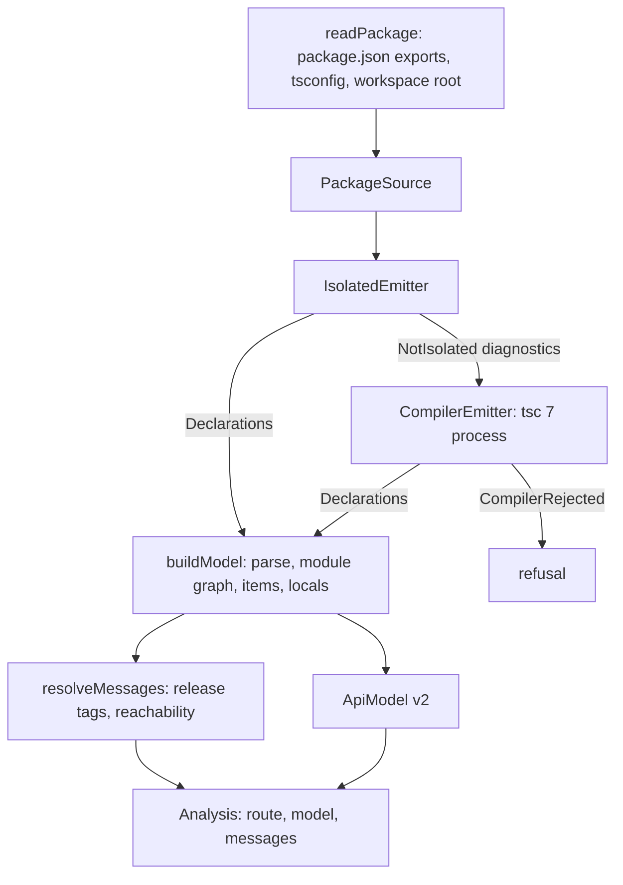

# API extractor front-ends - Plan

## Goal Capsule

- **Objective:** a maintainer points the engine at a TypeScript package's source and gets its versioned API model and analysis messages, without a type-check when the package's exports are annotated and through the compiler otherwise, and both routes give the same model.
- **Means:** one emitter port with an isolated-declarations adapter and a TypeScript 7 `tsc` process adapter, meeting one syntactic builder and resolver at declaration text (KTD1, KTD3, KTD5, KTD6); the fast-path emitter follows the committed profile (KTD2).
- **Product authority:** the operator's U7 / PR3 contract of 2026-10-12, then `docs/plans/2026-10-10-1146-feat-effect-api-extractor-plan.md` (R15, R17, R18; KTD9, KTD11, KTD13; the model and verdict contract and the provenance rules R1, R2, R7), then `AGENTS.md`. The report renderer and differential lane (PR4), the CI benchmark (PR5) and the CLI, bump check and journey (PR6) are not active scope.
- **Open blockers:** none for planning. Two delivery decisions belong to the operator and are held until the PR (Outstanding Questions).
- **Stop conditions:** stop and report if the profile shows neither candidate agreeing with TypeScript 7 on which corpus packages are isolated-clean (KTD2), if real declaration text needs a model shape `schemaVersion` 2 cannot hold, or if a resolver divergence from upstream (R10) traces to reachability no type position in the declaration text spells (alias indirection, conditional or mapped types, generic instantiation): that is a checker-only message for the operator and origin KTD13's fallback routing, not a resolver bug to widen.
- **Execution profile:** branch `feat/front-ends` from `origin/main` `9bd73962`, one PR. The agent implements, reviews report-only, and opens the PR; the operator rules on findings and merges.

---

## Product Contract

### Summary

The engine gains its two front-ends. An isolated-declarations fast path and a TypeScript 7 compiler fallback emit declaration text behind one emitter port. One syntactic builder turns that text into the existing versioned model, and one syntactic resolver derives api-extractor's analysis messages from it. A committed per-phase profile on the real corpus picks the fast-path emitter before any code depends on it.

### Problem Frame

PR1 and PR2 built the model, the diff and the verdict, but nothing produces a model from a real package: every model so far is hand-built or generated from the schema. The model schema was sized for the verdict and has never met real declaration text (origin U2). The origin plan's speed claim rests on a fast path that never type-checks, yet no isolatedDeclarations-clean package exists to take it, and the repository's own package fails `--isolatedDeclarations` with 52 errors today. TypeScript 7 ships no stable programmatic API, so the compiler can only be reached as a process until 7.1, and the choice between TypeScript's `transpileDeclaration` and `oxc-transform` for the fast path has no measurement behind it (origin R15).

### Key Decisions

- **Analysis messages travel beside the model in PR3, not inside it.** The origin's KTD10 moves messages into the model together with declaration spans and TSDoc in PR4, which bumps `schemaVersion` there; adding them now would bump it twice. Governs R3, R11.
- **The route is decided by the fast emitter's own evidence, not by a tsconfig flag.** A package is isolated-clean when its sources emit isolated declarations without a diagnostic; a configuration that claims cleanliness proves nothing (pack: boundary-testing, staged-protocol-evidence.md). Governs R1, R2.
- **The resolver covers the messages computed from the module graph and release tags.** The `{@inheritDoc}` and `{@link}` messages need TSDoc declaration-reference parsing, which arrives with the model's TSDoc in PR4. Governs R9.
- **A failing compile is refused, never modelled.** A model built from declarations the compiler flagged would carry `any` where the source meant something else, and a verdict over it would pass silently. Governs R5.

### Requirements

**Routing and emitters**

- R1. A package whose entry sources and the sources they reach emit isolated declarations without a diagnostic takes the fast path, and no type checker runs for it (origin R17).
- R2. Every other package with a TypeScript source entry takes the compiler fallback, TypeScript 7 `tsc` run as a process, and the result names the isolated-declaration diagnostics that routed it there.
- R3. Both paths give the same model, `schemaVersion` 2, for the same package, built from the same declaration files (those the entry points reach); only `producer.declarations` differs, and it names the emitter and version that produced the declarations (origin R7, R17).
- R4. Both emitters implement one emitter port, so a TypeScript 7.1 API adapter can replace the process adapter with no model schema change (origin R18).
- R5. A fallback compile that reports diagnostics is refused with those diagnostics.
- R16. A package with no TypeScript source entry is refused as having no front-end input, before either emitter runs.

**Model builder**

- R6. One syntactic builder turns declaration text into the model on both paths and reads no type checker.
- R7. Declarations that differ only in printing build the same model: quote style, member separators, whitespace, and `import("x").Y` against an imported `Y`.
- R8. A type the model's structure does not decompose is kept as canonical text, so changing it still registers as a change.

**Analysis messages**

- R9. A syntactic resolver over the same declaration text reports `ae-forgotten-export`, `ae-missing-release-tag`, `ae-internal-missing-underscore`, `ae-incompatible-release-tags` and `ae-internal-mixed-release-tag` (origin KTD13).
- R10. On a real package, the resolver reports the same message ids and symbols for those five messages as upstream api-extractor 7.59.1 run on the same declarations.
- R11. A message locates itself by entry point and declaration name, never by file offset, so both paths report the same messages for the same package.

**Profile**

- R12. A per-phase profile on the origin's KTD11 corpus is committed before the fast-path emitter is chosen. It times source discovery, both fast-path candidates, the TypeScript 7 fallback and declaration parsing per package, and it records how often TypeScript 7 and TypeScript 5.9.3 print a package's declarations differently (origin R15, KTD9).
- R13. The profile is reproducible from a committed harness and states the corpus commit, the toolchain versions and the host it ran on.
- R14. The fast-path emitter is the one the committed profile supports, and the choice cites it.

**Fast-path corpus**

- R15. This repository's package is isolatedDeclarations-clean, and its build fails if it stops being clean.

### Acceptance Examples

- AE1. **Covers R1, R3.** **Given** this repository's package, **when** the engine analyses it, **then** it takes the fast path; **and when** the fallback is run on the same package, its model serialises to the same bytes once `producer.declarations` is set equal.
- AE2. **Covers R2.** **Given** a package that exports `const ids = [1, 2].map(String)` with no annotation, **when** the engine analyses it, **then** it takes the fallback and the routing reason names the TS9010 diagnostic for `ids`.
- AE3. **Covers R7.** **Given** one declaration file that writes `import("effect").Effect.Effect<A>` and another that imports `Effect` from `effect` and writes `Effect.Effect<A>`, **when** both are built, **then** both give the reference `Effect.Effect` from module `effect`.
- AE4. **Covers R9, R11.** **Given** an exported function whose return type names an interface the entry point does not export, **when** the resolver runs, **then** it reports `ae-forgotten-export` for that interface at the function's name, and a type imported from another package draws no message.
- AE5. **Covers R5.** **Given** a package whose fallback compile reports a type error, **when** the engine analyses it, **then** it refuses with the compiler's diagnostic and builds no model.

### Scope Boundaries

- The `.api.md` renderer, the differential lane against upstream and the adversarial corpus are PR4 (origin U8).
- The cold and warm benchmark in CI is PR5 (origin U9). This PR's profile runs locally and is committed as evidence.
- The CLI, the changeset-bump check and the consumer-flake journey are PR6 (origin U10).
- Declaration spans, TSDoc text and messages inside the model, and the `schemaVersion` bump they bring, are PR4 (origin KTD10).
- The `{@inheritDoc}` and `{@link}` messages are PR4.
- The oracle-line TypeScript 5.9.3 adapter that origin KTD9 adds where TypeScript 7 prints differently serves the report path, so it is PR4; this PR measures the divergence it depends on.
- No mutation run, local or otherwise; no copied systemfsoftware tooling or packs.

### Outstanding Questions

**Resolve Before Planning:** none.

**Deferred to the operator (delivery, before the PR):**

- The change intent's bump for `@systemfsoftware/api-extractor`. `.changeset/README.md` requires a non-`none` intent for any change to `packages/api-extractor` while the package sits at 0.0.0 beside the `v0.0.0` tag, and the first non-`none` bump is the operator's call (`docs/plans/2026-10-10-2113-fix-release-version-surface-plan.md`, Scope Boundaries).
- Whether this branch stacks on PR #5. The operator cut it from `origin/main`; `AGENTS.md` OP13b stacks a branch that shares files with an open PR by the same author, and PR #5 also changes `pnpm-lock.yaml`, `pnpm-workspace.yaml` and `README.md`.

### Sources

- Origin plan: `docs/plans/2026-10-10-1146-feat-effect-api-extractor-plan.md` (R7, R15, R17, R18; KTD9, KTD10, KTD11, KTD13; U7).
- Learnings: `docs/solutions/design-patterns/keyed-uniqueness-in-the-api-model-schema.md` (item names are labels that may repeat; entry-point paths and enum member names are identities), `docs/solutions/build-errors/turbo-stale-cache-with-source-condition-dependencies.md` (any new consumer of the package's source depends on `transit`).
- Corpus: systemfsoftware at `732f66a0c85819b2005f9e0930a595bc4de91ee1` (the flake's pin), 43 public packages, 37 with a TypeScript source entry.
- Packs declared in `.compound-engineering/config.yaml` (systemfsoftware `df908ddfe497e53c1c03b92519a96c913c441a58`): cell-architecture, boundary-testing, schema-laws, package-topology.

---

## Planning Contract

Product Contract preservation: Product Contract unchanged.

### Key Technical Decisions

- KTD1. **One emitter port, two service tags, adapters as parameterised layers.** `src/front-end/declaration-emitter.service.ts` holds the `DeclarationEmitter` shape (`emit(source) -> Declarations`) and two `Context.Service` tags, `IsolatedEmitter` and `CompilerEmitter`, with no driver imports (pack: cell-architecture, ports-separate-from-layers.md; pack: cell-architecture, service-and-layer-boundaries.md). Each adapter module exports a `layer` (the compiler's takes options); no `*Live` identifier exists. A TypeScript 7.1 API adapter provides `CompilerEmitter` the same way; 7.0.2's `typescript/unstable/sync` API has no declaration-emit request, so the process adapter is the only 7.0 route. Governs R4.
- KTD2. **The fast-path emitter is chosen by a pre-registered rule over the committed profile.** Candidates: `oxc-transform` 0.150.0 `isolatedDeclarationSync` and TypeScript 5.9.3 `transpileDeclaration` (5.9.3 is already in the lockfile through `@microsoft/api-extractor`, and TypeScript 7 has no JavaScript emit API). The declaration parser follows the emitter's family: `oxc-parser` 0.150.0 or TypeScript 5.9.3 `createSourceFile`. Rule, in order: (1) the candidate's clean-or-not verdict matches TypeScript 7 `tsc --isolatedDeclarations` on every corpus package; (2) the lower corpus total of median warm emit plus parse time wins; (3) within 10%, the smaller runtime dependency wins. The choice and the numbers it rests on are recorded in a `Decision` section of `docs/profiles/2026-10-12-front-end-phases.md`, in a commit after the one that adds the profile. Governs R12, R14.
- KTD3. **The fallback runs the `tsc` of this package's own `typescript@7.0.2` dependency as a child process.** `typescript` moves from `devDependencies` to `dependencies` so the stamp `typescript@7.0.2` names what ran. The adapter runs `-p <tsconfig> --noEmit false --declaration --emitDeclarationOnly --declarationMap false --sourceMap false --incremental false --composite false --tsBuildInfoFile null --rootDir <workspace root> --outDir <scoped temp dir> --listEmittedFiles --pretty false` through effect's `ChildProcessSpawner`. Its `TSFILE:` lines and diagnostics are decoded with schemas (pack: cell-architecture, decode-never-cast.md). Any `error TS` line or non-zero exit is `CompilerRejected` with the diagnostics (R5). The workspace root is the nearest ancestor holding `pnpm-workspace.yaml`, else the package root, because family packages resolve sibling sources through `@systemfsoftware/source` and TypeScript 7 refuses files outside `rootDir`. The adapter keeps only the emitted files under the package root that the entry declarations reach through relative specifiers, the same closure the isolated adapter walks, so both `Declarations` hold the same file set (R3). Governs R2, R3, R4, R5.
- KTD4. **The route is a tagged union built from the isolated emitter's outcome.** `Route` is `FastPath` or `Fallback { diagnostics }`; `NotIsolated { diagnostics }` from `IsolatedEmitter` is the only thing that selects the fallback (pack: schema-laws, tagged-unions-over-state-by-presence.md; pack: boundary-testing, staged-protocol-evidence.md). A package without a TypeScript source entry never reaches routing: `readPackage` fails with `NoSourceEntry`, since neither route can produce a model for it (R16). Governs R1, R2, R16.
- KTD5. **`Declarations` is the meeting point of every front-end.** It holds the producer stamp, the declaration files as package-relative POSIX paths with their text in code-unit order, and each entry point's declaration file. Entry points come from `package.json` `exports`, reading each export's `@systemfsoftware/source` condition (the family's convention, an option of the package reader); `./package.json` and non-TypeScript targets are skipped. The tsconfig is `tsconfig.build.json` when present, else `tsconfig.json`. Governs R3, R6.
- KTD6. **The builder walks a syntactic module graph and maps type nodes onto the existing `TypeExpr` AST.** Relative specifiers resolve by swapping `.js`, `.ts`, `.mjs` or no extension for `.d.ts`, then `/index.d.ts`. A reference's `name` is the qualified name as written (`Effect.Effect`), and `module` is the bare specifier its leftmost identifier was imported from; `import("x").Y` becomes the same reference, and a relative `import("./y").Z` becomes a local one (R7). Keywords, literals, references, unions, intersections, arrays, plain tuples, function types, and object literals of properties, methods and call signatures decompose. Every other node becomes `text`, printed from the AST by one canonical printer, so formatting never reaches the model (R8). Items follow the model's kinds: `export * as ns` and `declare namespace` become namespaces, overloads group into one function, `export default` is an item named `default`. `locals` holds every type alias reachable from an export and not exported. Two distinct locals sharing a name take upstream's `_2`, `_3` suffixes in code-unit order of their file paths, and references follow the rename. `export =` and `declare global` are refused with `UnsupportedDeclaration`, naming the construct and file. Governs R6, R7, R8.
- KTD7. **The resolver reads release tags from the declaration's leading `/** */` comment and the module graph from KTD6.** A forgotten export is a declaration in the package's own files that an exported item's type positions, heritage clauses or `typeof` queries reach, and that the entry point does not export under any name or namespace. Type parameters, globals and other packages' types never count. A message is `{ messageId, entryPoint, item, symbol }` in code-unit order, with `item` the exported item's name path (R11). The five ids follow api-extractor 7.59.1's semantics, checked against upstream run in-process with `Extractor.invoke` (R10). Governs R9, R10, R11.
- KTD8. **The public surface is one `FrontEnd` namespace from `mod.ts`.** It exports `analyse`, `readPackage`, `buildModel`, `resolveMessages`, the two tags, the adapter layers, and the `Declarations`, `Analysis`, `AnalysisMessage`, `Route` schemas and error classes every signature reaches (pack: cell-architecture, single-namespace-barrel.md; pack: package-topology, enumerated-entry-modules.md; pack: package-topology, one-access-path.md; pack: package-topology, public-signature-types.md). `analyse` returns `{ route, model, messages }` and needs `IsolatedEmitter | CompilerEmitter` plus the platform services the adapters need. Governs R1-R5, R9.
- KTD9. **Cleanliness is enforced by the build.** `packages/api-extractor/tsconfig.build.json` sets `isolatedDeclarations: true`; tsdown's declaration build reads it, so the CI build lane fails when an export loses its annotation. TypeScript refuses an `extends` expression (TS9021) and a computed class member (TS9038) under `--isolatedDeclarations`. The schema classes `Verdict` and `CompareSurfaces` therefore become exported constants typed `Schema.Class<…>` beside an instance type of the same name, which also keeps `effect-schema-discovery` generating their codec laws (it recognises a const whose type names `Schema`, not a class extending a typed base). The error classes extend typed base constants, and the brand and instrumentation keys move onto the class value and prototype. The flag also moves tsdown's declaration generator (rolldown-plugin-dts) from `tsgo` to `oxc`, so `dist/mod.d.ts` changes in printing: quote style, named field types where the old file inlined them, `override` modifiers. No exported name changes, and the package is unpublished at 0.0.0. `attw` checks the built entry. Verdict output bytes do not change: `apps/api-extractor-e2e/host-digest.ts` keeps printing `e4478f03…6da2`. Governs R15.
- KTD10. **The profile harness is a private workspace app, run locally, its output committed under `docs/profiles/`.** `apps/api-extractor-profile` takes the corpus root and this repository's package; per package it times one cold and five warm runs of each phase and records the medians, the clean-or-not verdict of each candidate and of `tsc --isolatedDeclarations`, and the number of declaration files TypeScript 7 and TypeScript 5.9.3 print differently. TypeScript 5.9.3 is installed as the alias `typescript-5.9`. The first profile (discovery, emit, parse, divergence) is committed before KTD2's choice. A second run after the builder adds the build and resolve phases and each corpus package's build outcome (a model, or the refused construct), which is the real-text check behind the second stop condition. Governs R12, R13.
- KTD11. **Tests follow the test-layer gate.** In-process integration features in `packages/api-extractor/tests/` cover the fast path on this package, the builder's canonical forms and the resolver against upstream. The three scenarios that spawn `tsc` (AE1, AE2, AE5) live in `apps/api-extractor-e2e`, which then holds four of its four allowed journeys, so a later PR retires one before adding another. No unit test targets an internal helper and no emitter is faked (pack: boundary-testing, no-mocks-on-internal-glue.md; pack: boundary-testing, real-system-oracles.md; pack: boundary-testing, fake-and-real-store-laws.md). Governs R1-R3, R5, R7, R10.
- KTD12. **Turbo owns every build, cache and task-graph decision here, and this unit adds none (house law, skill turbo-query-optimization).** Evidence from `turbo query` on turbo 2.10.12, base `9bd73962`:
  - `packageGraph`: three packages; `api-extractor-e2e` and `api-extractor-profile` each have one `development` edge to `@systemfsoftware/api-extractor`. No cycle warning appears on stderr.
  - `boundaries`: length 0.
  - `affectedTasks`: 14 tasks across all three packages, because the unit changes every package.
  - Task edges: lint, typecheck and test each depend on `transit` (`turbo.json:9`, `turbo.json:15`, `turbo.json:18`), and `transit` depends on `^transit` (`turbo.json:11-12`). Appending one byte to a source file of `@systemfsoftware/api-extractor` changed the `turbo run --dry=json` hash of every lint, typecheck, test and transit task in all three packages, including `api-extractor-e2e#test`, and restoring the byte restored every hash. Turbo therefore already invalidates the new tests that read the package's source through the source condition.
  - The profile is a package script (`apps/api-extractor-profile/package.json:13`) with no `turbo.json` task, because its output is wall-clock timing and is never cacheable.
  - The unit's source, harness, tests and workflows contain no home-grown cache, hash, affected-only script or cache gate.
  - CI runs `pnpm lint`, `pnpm typecheck` and `pnpm build`, which are `turbo run …` (`package.json:12-15`), through systemfsoftware `reusable-checks.yml@732f66a0` (`.github/workflows/ci.yml:48-50`). That workflow sets Turbo's remote cache only when `turbo-team` is given (`reusable-checks.yml:115-125`, `:147-154`). `ci.yml` sets none, so public CI holds no Turbo credentials. Its Turbo-hash-driven test skip (`dry-run`, `reusable-checks.yml:110-114`, `:189-197`) is unused.

  Carrying `.turbo` through GitHub's cache action, or enabling `dry-run`, is CI speed work that belongs to the CI benchmark unit (PR5), not to U7.

### High-Level Technical Design

Directional, not an implementation specification.

The route decision has two outcomes and one input: the isolated emitter's result. The 7.1 adapter replaces only the `CompilerEmitter` box.

### Assumptions

- The family's `@systemfsoftware/source` export condition names each entry's source module. A package without it is refused with `NoSourceEntry` (R16).
- `oxc-transform`'s and TypeScript's isolated-declaration diagnostics agree on which packages are clean; the profile checks this before KTD2 relies on it.
- An isolated-clean package's TypeScript 7 declarations differ from its isolated declarations only in printing, which KTD6 normalises. The real equality journey (AE1) is the check.

### Assumptions challenged (destructive review, Edge-First lens)

First cycle on this artifact; Edge-First was chosen because the plan's happy path is one well-formed package and the failure modes sit at its edges.

1. *An isolated emitter that reports no diagnostic proves the package clean.* Two emitters may disagree (Assumptions). The profile records each candidate's verdict beside `tsc --isolatedDeclarations` (KTD10), and KTD2's first rule rejects a candidate that disagrees on any corpus package.
2. *Every real declaration file fits the model.* `export =`, `declare global`, colliding local names and default exports all occur in published packages. KTD6 names the handling of each instead of letting the builder drop one silently.
3. *`tsc` output mirrors the package's source tree.* Family packages resolve sibling sources, which TypeScript 7 refuses outside `rootDir` (probe: TS5011 on `packages/effect-cell-types` without `--rootDir`). KTD3 roots the compile at the workspace and maps emitted files back by relative path.

Radical alternative considered: skip declaration emit on the fast path and build the model straight from the annotated source, which already contains every type the declaration would. Rejected: two builder inputs break origin approach B's single meeting point and double the surface R3's equality must hold over; the profile shows whether emit cost matters at all.

### Sequencing

U1 → U2 (profile committed) → U3 (choice recorded) → U4 → U5 → U6 → U7 → U8 → U9. U4's builder can start on TypeScript 7 output before U3 lands only once KTD2's parser is known, so U3 precedes it.

---

## Implementation Units

### U1. Make this package isolatedDeclarations-clean

- **Goal:** the package emits isolated declarations without a diagnostic, enforced by its build.
- **Requirements:** R15; KTD9.
- **Files:** `packages/api-extractor/tsconfig.build.json`, `packages/api-extractor/src/**/*.ts` (annotations), `packages/api-extractor/src/verdict.schema.ts`, `packages/api-extractor/src/verdict.cell.ts`, `packages/api-extractor/src/judge-surfaces.workflow.ts`.
- **Approach:** annotate every exported `const` (schemas with their `Schema.*` types, the workflow and the cell with `effect-cell-types`' made types), give each tagged class an explicitly typed base. No behaviour change.
- **Execution note:** refactor only; the host digest is the byte check.
- **Test expectation:** none - annotations, proven by `tsc -p tsconfig.build.json` and the unchanged suite.
- **Verification:** `tsc -p packages/api-extractor/tsconfig.build.json --noEmit` reports no TS9xxx; `pnpm build` passes; `pnpm test` passes; host digest `e4478f03…6da2`.

### U2. Profile harness and the first phase profile

- **Goal:** a reproducible per-phase profile on the real corpus, committed before the emitter choice.
- **Requirements:** R12, R13; KTD10.
- **Files:** `apps/api-extractor-profile/{package.json,tsconfig.json,oxlint.config.ts,profile.ts}`, `pnpm-workspace.yaml` (none expected beyond the workspace glob), `pnpm-lock.yaml`, `docs/profiles/2026-10-12-front-end-phases.json`, `docs/profiles/2026-10-12-front-end-phases.md`.
- **Approach:** corpus = systemfsoftware `732f66a0c8` checked out and installed with `pnpm install --frozen-lockfile --ignore-scripts`, plus `packages/api-extractor`. Phases per package: discovery (manifest and source graph), `oxc-transform` emit, `transpileDeclaration` emit, `tsc` 7 emit, `tsc` 5.9.3 emit (divergence only), `oxc-parser` parse, `createSourceFile` parse, and `tsc --isolatedDeclarations` diagnostics as the cleanliness referee. The JSON records corpus commit, versions, host CPU, Node version and per-phase medians; the markdown tables it.
- **Test expectation:** none - an evidence tool whose output is the committed profile.
- **Verification:** the harness runs end to end on the corpus; the JSON names commit `732f66a0c8` and both packages sets.

### U3. Emitter port, isolated adapter and the recorded choice

- **Goal:** the port and the chosen fast-path adapter exist, with the choice citing the profile.
- **Requirements:** R1, R4, R14; KTD1, KTD2, KTD4, KTD5.
- **Files:** `packages/api-extractor/src/front-end/declaration-emitter.service.ts`, `packages/api-extractor/src/front-end/declarations.schema.ts`, `packages/api-extractor/src/front-end/package-source.schema.ts` (reader), the chosen adapter module, `packages/api-extractor/package.json`, this plan's KTD2.
- **Approach:** the adapter emits each entry source, parses the emitted imports, and follows relative specifiers until the reachable set is closed; any diagnostic yields `NotIsolated`.
- **Test scenarios:** covered through U8's fast-path feature (this package emits with no diagnostic; route `FastPath`).
- **Verification:** U8.

### U4. Syntactic model builder

- **Goal:** `buildModel(declarations)` gives a schema-valid, sorted `ApiModel` v2.
- **Requirements:** R3, R6, R7, R8; KTD6.
- **Files:** `packages/api-extractor/src/front-end/declaration-graph.ts`, `packages/api-extractor/src/front-end/type-expr-of.ts`, `packages/api-extractor/src/front-end/canonical-type-text.ts`, `packages/api-extractor/src/front-end/build-model.ts`.
- **Approach:** KTD6; the model passes through `sortModel` and is stamped with `ENGINE` and the declarations' producer.
- **Test scenarios:** (`tests/front-end-model.integration.test.ts`) AE3 rows: `import("effect").Effect.Effect<A>` and an imported `Effect.Effect<A>` give one reference; a mapped type printed by `oxc` and by TypeScript gives one `text`; `export * as ns` gives a namespace item; two overloads give one function with two signatures; an unexported alias reached from an export lands in `locals`; `export =` is refused naming the file.
- **Verification:** the feature passes; this package's fast-path model decodes with `ApiModel.decode`.

### U5. Syntactic resolver

- **Goal:** `resolveMessages(declarations)` gives the five messages in code-unit order.
- **Requirements:** R9, R10, R11; KTD7.
- **Files:** `packages/api-extractor/src/front-end/analysis-message.schema.ts`, `packages/api-extractor/src/front-end/resolve-messages.ts`, `packages/api-extractor/tests/__fixtures__/upstream-messages.ts`, `packages/api-extractor/tests/analysis-messages.integration.test.ts`.
- **Test scenarios:** this package's fast-path declarations: the resolver's `(messageId, symbol)` set equals upstream 7.59.1's for the five ids. One declaration fixture per id, each checked against upstream rather than a hand-written answer: an unexported interface in a return type (AE4), an export without a release tag, an `@internal` export without `_`, a `@public` export whose type names a `@beta` one, and a merged declaration with two tags. A type from `effect` draws no message.
- **Verification:** the feature passes.

### U6. TypeScript 7 compiler adapter

- **Goal:** `CompilerEmitter` emits declarations by running `tsc` 7 and refuses on diagnostics.
- **Requirements:** R2, R4, R5; KTD3.
- **Files:** `packages/api-extractor/src/front-end/typescript-7-compiler.ts`, `packages/api-extractor/package.json` (`typescript` to `dependencies`).
- **Test scenarios:** U8's e2e journeys.
- **Verification:** U8.

### U7. Router and public surface

- **Goal:** `FrontEnd.analyse` routes per KTD4 and returns `{ route, model, messages }`.
- **Requirements:** R1, R2, R3; KTD4, KTD8.
- **Files:** `packages/api-extractor/src/front-end/analyse.ts`, `packages/api-extractor/src/FrontEnd.ts`, `packages/api-extractor/src/mod.ts`.
- **Test scenarios:** U8.
- **Verification:** `pnpm build` and `attw`: the `.mjs` and `.d.ts` entries agree on the new namespace (pack: package-topology, condition-branch-agreement.md).

### U8. Front-end features

- **Goal:** the Product Contract's acceptance examples run on real inputs.
- **Requirements:** R1, R2, R3, R5, R7, R10, R16; KTD11.
- **Files:** `packages/api-extractor/tests/front-end-model.integration.test.ts` (U4 rows plus: this package analysed in-process takes `FastPath` and its model decodes as `schemaVersion` 2; a package whose exports name no TypeScript source is refused with `NoSourceEntry`), `apps/api-extractor-e2e/tests/front-ends.integration.test.ts`, `apps/api-extractor-e2e/fixtures/inferred-export/`, `apps/api-extractor-e2e/fixtures/type-error/`, `apps/api-extractor-e2e/package.json`.
- **Test scenarios:** (e2e) AE1: this package through `IsolatedEmitter` and through `CompilerEmitter` serialises to the same bytes once `producer.declarations` is set equal, and both give the same messages; AE2: `fixtures/inferred-export` routes to `Fallback` naming TS9010 and builds a model; AE5: `fixtures/type-error` is refused with the compiler's diagnostic.
- **Verification:** `pnpm turbo run test --filter=@systemfsoftware/api-extractor --filter=api-extractor-e2e` passes.

### U9. Second profile and documentation

- **Goal:** the committed profile covers every phase, and the README says how front-ends route.
- **Requirements:** R12, R13.
- **Files:** `apps/api-extractor-profile/profile.ts`, `docs/profiles/2026-10-12-front-end-phases.{json,md}`, `README.md`.
- **Approach:** add `build` and `resolve` phases that call `FrontEnd.buildModel` and `FrontEnd.resolveMessages`, and the fallback model count; README gains the front-end section and the profile reproduction steps.
- **Test expectation:** none - evidence and documentation.
- **Verification:** the harness runs on the corpus with every phase present.

### U10. Review dispositions

- **Goal:** the operator-accepted findings of the full-path `ce-code-review` (run `20261012-174501-836c437c`, head `fd4ad93`) are fixed, each with a test that fails before the fix and passes after; rejected findings stay rejected.
- **Requirements:** R1, R3, R5, R6, R16; KTD9, KTD12.
- **Files:** `.changeset/*.md`, `packages/api-extractor/src/front-end/{compiler-output.schema,oxc-isolated-emitter,typescript-7-compiler,build-model}.ts`, `packages/api-extractor/tests/front-end-{routing,model}.integration.test.ts`, `apps/api-extractor-e2e/tests/front-ends.integration.test.ts`, `README.md`.
- **Approach:**
  - #1: a `minor` change intent for `@systemfsoftware/api-extractor`. The `FrontEnd` namespace is new public surface (pack: package-topology, surface-changes-are-versioned.md).
  - #2: `Position` is capped below 1e9 and digit text has one spelling, with no zero padding. Each refinement has a refusal law in its own file (pack: schema-laws, refusals-beside-generated-laws.md). The four committed `Refuted` seeds stay as regression coverage.
  - #5: the isolated emitter declines with `NotIsolated`, naming the declaration file, when an entry point's source cannot be read.
  - #6: the fallback passes `--stripInternal false`, so both routes keep `@internal` declarations.
  - #9: an entry point's declarations load from its recorded source path before any sibling candidate.
  - Requirements-check advisory: an enum member with a computed declared value is refused with `UnsupportedDeclaration` naming the member. Both emitters print constant members as literals and omit non-constant initializers, so only declaration text written by hand carries one.
  - README: the builder's refusals (external re-export, `declare global`, module augmentation, `export =`, computed enum value) are documented as limitations.
  - Rejected: #4. tsc 7.0.2 imports a non-exported interface from an import-bearing `.d.ts` (exit 0), and adding `export {}` makes the same import TS2459. The validator rejected #3, #7, #8 and #10-#16.
- **Test expectation:** the routing feature gains a missing-entry scenario and a `.tsx`-beside-`.ts` scenario; the model feature gains a computed-enum refusal; the e2e equality journey gains an `@internal` package without adding a journey (KTD11). Each fails at `fd4ad93` and passes after its fix. Each refusal law fails when its refinement is widened.
- **Verification:** the Verification Contract gates, plus a delta review of the fixes by a named non-Claude cross-model peer (DeepSeek or MiniMax only).

---

## Verification Contract

| Gate | Command or evidence | Proves |
|---|---|---|
| Isolated-clean package | `nix develop --command sh -c 'cd packages/api-extractor && tsc -p tsconfig.build.json --noEmit'` reports no TS9xxx; CI `build · attw` lane | R15 |
| Targeted tests | `nix develop --command pnpm turbo run test --filter=@systemfsoftware/api-extractor --filter=api-extractor-e2e` | R1-R3, R5, R7, R9-R11, R16 |
| Lint and typecheck | `nix develop --command pnpm lint` and `pnpm typecheck` (0 diagnostics) | AGENTS.md preset rule |
| Build | `nix develop --command pnpm build` and `pnpm --filter @systemfsoftware/api-extractor attw` | R4, KTD8 |
| Host digest | `node --conditions=@systemfsoftware/source apps/api-extractor-e2e/host-digest.ts \| sha256sum` gives `e4478f03…6da2` | output bytes unchanged |
| Profile before choice | `git merge-base --is-ancestor <commit adding docs/profiles/2026-10-12-front-end-phases.json> <commit adding its Decision section>` exits 0, and the two commits differ | R12, R14 |
| Profile reproduction | `node --conditions=@systemfsoftware/source apps/api-extractor-profile/profile.ts <corpus> <out>` on the corpus at `732f66a0c8` | R13 |
| No locale APIs | `git grep -nE 'toLocale\|localeCompare\|Intl\\.' -- packages/api-extractor/src` prints nothing | origin R5 |
| CI | `ci.yml` and Changeset Check green on the exact PR head | origin R22 |

No mutation run, local or in CI (origin R23).

---

## Definition of Done

- U1-U10 verified; every Verification Contract gate passes locally and CI is green on the exact PR head.
- The commit adding the profile precedes the commit adding its `Decision` section, which records the emitter choice with the profile's numbers.
- Report-only `ce-code-review` findings carry a ruling table, and only operator-accepted fixes are applied.
- The two delivery questions are ruled by the operator before the PR opens.
- No scratch, abandoned-attempt code or throwaway probe remains in the diff.
