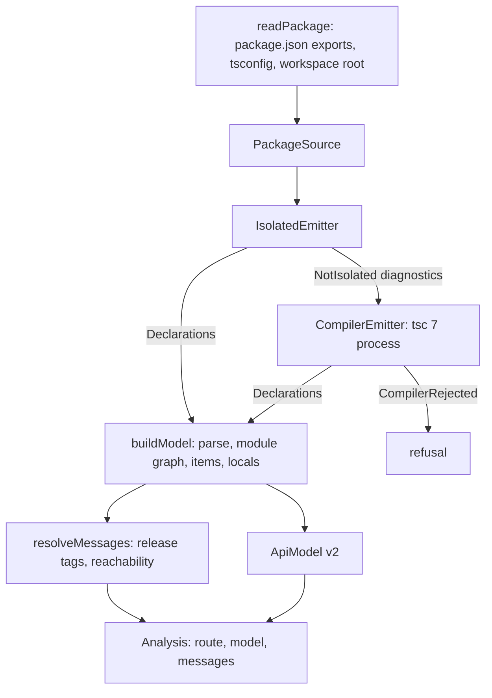

# API extractor front-ends - Plan

## Goal Capsule

- **Objective:** a maintainer points the engine at a TypeScript package's source and gets its versioned API model and analysis messages, without a type-check when the package's exports are annotated and through the compiler otherwise, and both routes give the same model.
- **Means:** one emitter port with an isolated-declarations adapter and a TypeScript 7 `tsc` process adapter, meeting one syntactic builder and resolver at declaration text (KTD1, KTD3, KTD5, KTD6); the fast-path emitter follows the committed profile (KTD2).
- **Product authority:** the operator's U7 / PR3 contract of 2026-10-12, then `docs/plans/2026-10-10-1146-feat-effect-api-extractor-plan.md` (R15, R17, R18; KTD9, KTD11, KTD13; the model and verdict contract and the provenance rules R1, R2, R7), then `AGENTS.md`. The report renderer and differential lane (PR4), the CI benchmark (PR5) and the CLI, bump check and journey (PR6) are not active scope.
- **Open blockers:** none for planning. Two delivery decisions belong to the operator and are held until the PR (Outstanding Questions).
- **Stop conditions:** stop and report if the profile shows neither candidate agreeing with TypeScript 7 on which corpus packages are isolated-clean (KTD2), if real declaration text needs a model shape `schemaVersion` 2 cannot hold, or if a resolver divergence from upstream (R10) traces to reachability no type position in the declaration text spells (alias indirection, conditional or mapped types, generic instantiation): that is a checker-only message for the operator and origin KTD13's fallback routing, not a resolver bug to widen.
- **Execution profile:** branch `feat/front-ends` from `origin/main` `9bd73962`, one PR. The agent implements, reviews report-only, and opens the PR; the operator rules on findings and merges.

---

## Product Contract

### Summary

The engine gains its two front-ends. An isolated-declarations fast path and a TypeScript 7 compiler fallback emit declaration text behind one emitter port. One syntactic builder turns that text into the existing versioned model, and one syntactic resolver derives api-extractor's analysis messages from it. A committed per-phase profile on the real corpus picks the fast-path emitter before any code depends on it.

### Problem Frame

PR1 and PR2 built the model, the diff and the verdict, but nothing produces a model from a real package: every model so far is hand-built or generated from the schema. The model schema was sized for the verdict and has never met real declaration text (origin U2). The origin plan's speed claim rests on a fast path that never type-checks, yet no isolatedDeclarations-clean package exists to take it, and the repository's own package fails `--isolatedDeclarations` with 52 errors today. TypeScript 7 ships no stable programmatic API, so the compiler can only be reached as a process until 7.1, and the choice between TypeScript's `transpileDeclaration` and `oxc-transform` for the fast path has no measurement behind it (origin R15).

### Key Decisions

- **Analysis messages travel beside the model in PR3, not inside it.** The origin's KTD10 moves messages into the model together with declaration spans and TSDoc in PR4, which bumps `schemaVersion` there; adding them now would bump it twice. Governs R3, R11.
- **The route is decided by the fast emitter's own evidence, not by a tsconfig flag.** A package is isolated-clean when its sources emit isolated declarations without a diagnostic; a configuration that claims cleanliness proves nothing (pack: boundary-testing, staged-protocol-evidence.md). Governs R1, R2.
- **The resolver covers the messages computed from the module graph and release tags.** The `{@inheritDoc}` and `{@link}` messages need TSDoc declaration-reference parsing, which arrives with the model's TSDoc in PR4. Governs R9.
- **A failing compile is refused, never modelled.** A model built from declarations the compiler flagged would carry `any` where the source meant something else, and a verdict over it would pass silently. Governs R5.

### Requirements

**Routing and emitters**

- R1. A package whose entry sources and the sources they reach emit isolated declarations without a diagnostic takes the fast path, and no type checker runs for it (origin R17).
- R2. Every other package with a TypeScript source entry takes the compiler fallback, TypeScript 7 `tsc` run as a process, and the result names the isolated-declaration diagnostics that routed it there.
- R3. Both paths give the same model, `schemaVersion` 2, for the same package, built from the same declaration files (those the entry points reach); only `producer.declarations` differs, and it names the emitter and version that produced the declarations (origin R7, R17).
- R4. Both emitters implement one emitter port, so a TypeScript 7.1 API adapter can replace the process adapter with no model schema change (origin R18).
- R5. A fallback compile that reports diagnostics is refused with those diagnostics.
- R16. A package with no TypeScript source entry is refused as having no front-end input, before either emitter runs.

**Model builder**

- R6. One syntactic builder turns declaration text into the model on both paths and reads no type checker.
- R7. Declarations that differ only in printing build the same model: quote style, member separators, whitespace, and `import("x").Y` against an imported `Y`.
- R8. A type the model's structure does not decompose is kept as canonical text, so changing it still registers as a change.

**Analysis messages**

- R9. A syntactic resolver over the same declaration text reports `ae-forgotten-export`, `ae-missing-release-tag`, `ae-internal-missing-underscore`, `ae-incompatible-release-tags` and `ae-internal-mixed-release-tag` (origin KTD13).
- R10. On a real package, the resolver reports the same message ids and symbols for those five messages as upstream api-extractor 7.59.1 run on the same declarations.
- R11. A message locates itself by entry point and declaration name, never by file offset, so both paths report the same messages for the same package.

**Profile**

- R12. A per-phase profile on the origin's KTD11 corpus is committed before the fast-path emitter is chosen. It times source discovery, both fast-path candidates, the TypeScript 7 fallback and declaration parsing per package, and it records how often TypeScript 7 and TypeScript 5.9.3 print a package's declarations differently (origin R15, KTD9).
- R13. The profile is reproducible from a committed harness and states the corpus commit, the toolchain versions and the host it ran on.
- R14. The fast-path emitter is the one the committed profile supports, and the choice cites it.

**Fast-path corpus**

- R15. This repository's package is isolatedDeclarations-clean, and its build fails if it stops being clean.

### Acceptance Examples

- AE1. **Covers R1, R3.** **Given** this repository's package, **when** the engine analyses it, **then** it takes the fast path; **and when** the fallback is run on the same package, its model serialises to the same bytes once `producer.declarations` is set equal.
- AE2. **Covers R2.** **Given** a package that exports `const ids = [1, 2].map(String)` with no annotation, **when** the engine analyses it, **then** it takes the fallback and the routing reason names the TS9010 diagnostic for `ids`.
- AE3. **Covers R7.** **Given** one declaration file that writes `import("effect").Effect.Effect<A>` and another that imports `Effect` from `effect` and writes `Effect.Effect<A>`, **when** both are built, **then** both give the reference `Effect.Effect` from module `effect`.
- AE4. **Covers R9, R11.** **Given** an exported function whose return type names an interface the entry point does not export, **when** the resolver runs, **then** it reports `ae-forgotten-export` for that interface at the function's name, and a type imported from another package draws no message.
- AE5. **Covers R5.** **Given** a package whose fallback compile reports a type error, **when** the engine analyses it, **then** it refuses with the compiler's diagnostic and builds no model.

### Scope Boundaries

- The `.api.md` renderer, the differential lane against upstream and the adversarial corpus are PR4 (origin U8).
- The cold and warm benchmark in CI is PR5 (origin U9). This PR's profile runs locally and is committed as evidence.
- The CLI, the changeset-bump check and the consumer-flake journey are PR6 (origin U10).
- Declaration spans, TSDoc text and messages inside the model, and the `schemaVersion` bump they bring, are PR4 (origin KTD10).
- The `{@inheritDoc}` and `{@link}` messages are PR4.
- The oracle-line TypeScript 5.9.3 adapter that origin KTD9 adds where TypeScript 7 prints differently serves the report path, so it is PR4; this PR measures the divergence it depends on.
- No mutation run, local or otherwise; no copied systemfsoftware tooling or packs.

### Outstanding Questions

**Resolve Before Planning:** none.

**Deferred to the operator (delivery, before the PR):**

- The change intent's bump for `@systemfsoftware/api-extractor`. `.changeset/README.md` requires a non-`none` intent for any change to `packages/api-extractor` while the package sits at 0.0.0 beside the `v0.0.0` tag, and the first non-`none` bump is the operator's call (`docs/plans/2026-10-10-2113-fix-release-version-surface-plan.md`, Scope Boundaries).
- Whether this branch stacks on PR #5. The operator cut it from `origin/main`; `AGENTS.md` OP13b stacks a branch that shares files with an open PR by the same author, and PR #5 also changes `pnpm-lock.yaml`, `pnpm-workspace.yaml` and `README.md`.

### Sources

- Origin plan: `docs/plans/2026-10-10-1146-feat-effect-api-extractor-plan.md` (R7, R15, R17, R18; KTD9, KTD10, KTD11, KTD13; U7).
- Learnings: `docs/solutions/design-patterns/keyed-uniqueness-in-the-api-model-schema.md` (item names are labels that may repeat; entry-point paths and enum member names are identities), `docs/solutions/build-errors/turbo-stale-cache-with-source-condition-dependencies.md` (any new consumer of the package's source depends on `transit`).
- Corpus: systemfsoftware at `732f66a0c85819b2005f9e0930a595bc4de91ee1` (the flake's pin), 43 public packages, 37 with a TypeScript source entry.
- Packs declared in `.compound-engineering/config.yaml` (systemfsoftware `df908ddfe497e53c1c03b92519a96c913c441a58`): cell-architecture, boundary-testing, schema-laws, package-topology.

---

## Planning Contract

Product Contract preservation: Product Contract unchanged.

### Key Technical Decisions

- KTD1. **One emitter port, two service tags, adapters as parameterised layers.** `src/front-end/declaration-emitter.service.ts` holds the `DeclarationEmitter` shape (`emit(source) -> Declarations`) and two `Context.Service` tags, `IsolatedEmitter` and `CompilerEmitter`, with no driver imports (pack: cell-architecture, ports-separate-from-layers.md; pack: cell-architecture, service-and-layer-boundaries.md). Each adapter module exports a `layer` (the compiler's takes options); no `*Live` identifier exists. A TypeScript 7.1 API adapter provides `CompilerEmitter` the same way; 7.0.2's `typescript/unstable/sync` API has no declaration-emit request, so the process adapter is the only 7.0 route. Governs R4.
- KTD2. **The fast-path emitter is chosen by a pre-registered rule over the committed profile.** Candidates: `oxc-transform` 0.150.0 `isolatedDeclarationSync` and TypeScript 5.9.3 `transpileDeclaration` (5.9.3 is already in the lockfile through `@microsoft/api-extractor`, and TypeScript 7 has no JavaScript emit API). The declaration parser follows the emitter's family: `oxc-parser` 0.150.0 or TypeScript 5.9.3 `createSourceFile`. Rule, in order: (1) the candidate's clean-or-not verdict matches TypeScript 7 `tsc --isolatedDeclarations` on every corpus package; (2) the lower corpus total of median warm emit plus parse time wins; (3) within 10%, the smaller runtime dependency wins. The choice and the numbers it rests on are recorded in a `Decision` section of `docs/profiles/2026-10-12-front-end-phases.md`, in a commit after the one that adds the profile. Governs R12, R14.
- KTD3. **The fallback runs the `tsc` of this package's own `typescript@7.0.2` dependency as a child process.** `typescript` moves from `devDependencies` to `dependencies` so the stamp `typescript@7.0.2` names what ran. The adapter runs `-p <tsconfig> --noEmit false --declaration --emitDeclarationOnly --declarationMap false --sourceMap false --incremental false --composite false --tsBuildInfoFile null --rootDir <workspace root> --outDir <scoped temp dir> --listEmittedFiles --pretty false` through effect's `ChildProcessSpawner`. Its `TSFILE:` lines and diagnostics are decoded with schemas (pack: cell-architecture, decode-never-cast.md). Any `error TS` line or non-zero exit is `CompilerRejected` with the diagnostics (R5). The workspace root is the nearest ancestor holding `pnpm-workspace.yaml`, else the package root, because family packages resolve sibling sources through `@systemfsoftware/source` and TypeScript 7 refuses files outside `rootDir`. The adapter keeps only the emitted files under the package root that the entry declarations reach through relative specifiers, the same closure the isolated adapter walks, so both `Declarations` hold the same file set (R3). Governs R2, R3, R4, R5.
  - **Amended by U12.** `tsc`'s stdout is package-influenced text: a module specifier or file name containing a newline puts a well-formed `error TS…` or `file(l,c): error TS…` line on stdout (reproduced on 7.0.2, run `20261013-163200-2c130632` #3), so no line grammar can tell a real diagnostic from a forged one. The adapter therefore reads no stdout. It writes one derived config, `{ "extends": <package tsconfig>, "compilerOptions": <emit policy> }`, where the emit policy is one exported record (`noEmit: false`, `declaration`, `emitDeclarationOnly`, `declarationMap: false`, `sourceMap: false`, `stripInternal: false`, `isolatedDeclarations: false`, `removeComments: false`, `incremental: false`, `composite: false`, `tsBuildInfoFile: null`, `rootDir: <workspace root>`, `outDir` and `declarationDir: <scoped temp dir>`), and runs `tsc -p <derived config>`. Emitted declarations are the `.d.ts` files found under the scoped directory. A non-zero exit is `CompilerRejected`; its diagnostics come from TypeScript 7.0.2's `typescript/unstable/async` API opened on the same derived config, following `tsc`'s reporting order (config and syntactic; else program and global; else semantic; then declaration), errors only, de-duplicated. The API runs only on a refusal, so a clean package pays nothing for it. If the API reports no error for a failed run, the refusal carries one diagnostic without a code naming the exit status and stderr. `references` are not carried into the derived config: without `--build`, `tsc -p` uses them only to redirect imports to referenced projects' built output, and the model reads only this package's declarations. The profile harness imports the same emit policy (U12). Settings that resolve from the config file's directory (the default `typeRoots` chain, a `types` entry naming a package, the default `include`) would otherwise resolve from a temp directory. The derived config is therefore written into a scoped mirror of the package config's directory, each ancestor carrying a symlink to the real `node_modules` unless the ancestor is itself named `node_modules` (`tsc` never looks inside one), and a mirrored `node_modules` segment renamed so it cannot collide with that symlink; `tsc`'s upward `node_modules` walk then matches the package's own (U13), and `files` is the package config's resolved `fileNames`, read once with the API's `parseConfigFile` (a tsconfig with no `include` otherwise matches `**/*` in the temp directory, TS18003). Each was reproduced on 7.0.2 and has an equality case in the e2e journey.
- KTD4. **The route is a tagged union built from the isolated emitter's outcome.** `Route` is `FastPath` or `Fallback { diagnostics }`; `NotIsolated { diagnostics }` from `IsolatedEmitter` is the only thing that selects the fallback (pack: schema-laws, tagged-unions-over-state-by-presence.md; pack: boundary-testing, staged-protocol-evidence.md). A package without a TypeScript source entry never reaches routing: `readPackage` fails with `NoSourceEntry`, since neither route can produce a model for it (R16). Governs R1, R2, R16.
- KTD5. **`Declarations` is the meeting point of every front-end.** It holds the producer stamp, the declaration files as package-relative POSIX paths with their text in code-unit order, and each entry point's declaration file. Entry points come from `package.json` `exports`, reading each export's `@systemfsoftware/source` condition (the family's convention, an option of the package reader); `./package.json` and non-TypeScript targets are skipped. The tsconfig is `tsconfig.build.json` when present, else `tsconfig.json`. Governs R3, R6.
- KTD6. **The builder walks a syntactic module graph and maps type nodes onto the existing `TypeExpr` AST.** Relative specifiers resolve by swapping `.js`, `.ts`, `.mjs` or no extension for `.d.ts`, then `/index.d.ts`. A reference's `name` is the qualified name as written (`Effect.Effect`), and `module` is the bare specifier its leftmost identifier was imported from; `import("x").Y` becomes the same reference, and a relative `import("./y").Z` becomes a local one (R7). Keywords, literals, references, unions, intersections, arrays, plain tuples, function types, and object literals of properties, methods and call signatures decompose. Every other node becomes `text`, printed from the AST by one canonical printer, so formatting never reaches the model (R8). Items follow the model's kinds: `export * as ns` and `declare namespace` become namespaces, overloads group into one function, `export default` is an item named `default`. `locals` holds every type alias reachable from an export and not exported. Two distinct locals sharing a name take upstream's `_2`, `_3` suffixes in code-unit order of their file paths, and references follow the rename. `export =` and `declare global` are refused with `UnsupportedDeclaration`, naming the construct and file. Governs R6, R7, R8.
- KTD7. **The resolver reads release tags from the declaration's leading `/** */` comment and the module graph from KTD6.** A forgotten export is a declaration in the package's own files that an exported item's type positions, heritage clauses or `typeof` queries reach, and that the entry point does not export under any name or namespace. Type parameters, globals and other packages' types never count. A message is `{ messageId, entryPoint, item, symbol }` in code-unit order, with `item` the exported item's name path (R11). The five ids follow api-extractor 7.59.1's semantics, checked against upstream run in-process with `Extractor.invoke` (R10). Governs R9, R10, R11.
- KTD8. **The public surface is one `FrontEnd` namespace from `mod.ts`.** It exports `analyse`, `readPackage`, `buildModel`, `resolveMessages`, the two tags, the adapter layers, and the `Declarations`, `Analysis`, `AnalysisMessage`, `Route` schemas and error classes every signature reaches (pack: cell-architecture, single-namespace-barrel.md; pack: package-topology, enumerated-entry-modules.md; pack: package-topology, one-access-path.md; pack: package-topology, public-signature-types.md). `analyse` returns `{ route, model, messages }` and needs `IsolatedEmitter | CompilerEmitter` plus the platform services the adapters need. Governs R1-R5, R9.
- KTD9. **Cleanliness is enforced by the build.** `packages/api-extractor/tsconfig.build.json` sets `isolatedDeclarations: true`; tsdown's declaration build reads it, so the CI build lane fails when an export loses its annotation. TypeScript refuses an `extends` expression (TS9021) and a computed class member (TS9038) under `--isolatedDeclarations`. The schema classes `Verdict` and `CompareSurfaces` therefore become exported constants typed `Schema.Class<…>` beside an instance type of the same name, which also keeps `effect-schema-discovery` generating their codec laws (it recognises a const whose type names `Schema`, not a class extending a typed base). The error classes extend typed base constants, and the brand and instrumentation keys move onto the class value and prototype. The flag also moves tsdown's declaration generator (rolldown-plugin-dts) from `tsgo` to `oxc`, so `dist/mod.d.ts` changes in printing: quote style, named field types where the old file inlined them, `override` modifiers. No exported name changes, and the package is unpublished at 0.0.0. `attw` checks the built entry. Verdict output bytes do not change: `apps/api-extractor-e2e/host-digest.ts` keeps printing `e4478f03…6da2`. Governs R15.
- KTD10. **The profile harness is a private workspace app, run locally, its output committed under `docs/profiles/`.** `apps/api-extractor-profile` takes the corpus root and this repository's package; per package it times one cold and five warm runs of each phase and records the medians, the clean-or-not verdict of each candidate and of `tsc --isolatedDeclarations`, and the number of declaration files TypeScript 7 and TypeScript 5.9.3 print differently. TypeScript 5.9.3 is installed as the alias `typescript-5.9`. The first profile (discovery, emit, parse, divergence) is committed before KTD2's choice. A second run after the builder adds the build and resolve phases and each corpus package's build outcome (a model, or the refused construct), which is the real-text check behind the second stop condition. Governs R12, R13.
- KTD11. **Tests follow the test-layer gate.** In-process integration features in `packages/api-extractor/tests/` cover the fast path on this package, the builder's canonical forms and the resolver against upstream. The three scenarios that spawn `tsc` (AE1, AE2, AE5) live in `apps/api-extractor-e2e`, which then holds four of its four allowed journeys, so a later PR retires one before adding another. No unit test targets an internal helper and no emitter is faked (pack: boundary-testing, no-mocks-on-internal-glue.md; pack: boundary-testing, real-system-oracles.md; pack: boundary-testing, fake-and-real-store-laws.md). Governs R1-R3, R5, R7, R10.
- KTD12. **Turbo owns every build, cache and task-graph decision here, and this unit adds none (house law, skill turbo-query-optimization).** Evidence from `turbo query` on turbo 2.10.12, base `9bd73962`:
  - `packageGraph`: three packages; `api-extractor-e2e` and `api-extractor-profile` each have one `development` edge to `@systemfsoftware/api-extractor`. No cycle warning appears on stderr.
  - `boundaries`: length 0.
  - `affectedTasks`: 14 tasks across all three packages, because the unit changes every package.
  - Task edges: lint, typecheck and test each depend on `transit` (`turbo.json:9`, `turbo.json:15`, `turbo.json:18`), and `transit` depends on `^transit` (`turbo.json:11-12`). Appending one byte to a source file of `@systemfsoftware/api-extractor` changed the `turbo run --dry=json` hash of every lint, typecheck, test and transit task in all three packages, including `api-extractor-e2e#test`, and restoring the byte restored every hash. Turbo therefore already invalidates the new tests that read the package's source through the source condition.
  - The profile is a package script (`apps/api-extractor-profile/package.json:13`) with no `turbo.json` task, because its output is wall-clock timing and is never cacheable.
  - The unit's source, harness, tests and workflows contain no home-grown cache, hash, affected-only script or cache gate.
  - CI runs `pnpm lint`, `pnpm typecheck` and `pnpm build`, which are `turbo run …` (`package.json:12-15`), through systemfsoftware `reusable-checks.yml@732f66a0` (`.github/workflows/ci.yml:48-50`). That workflow sets Turbo's remote cache only when `turbo-team` is given (`reusable-checks.yml:115-125`, `:147-154`). `ci.yml` sets none, so public CI holds no Turbo credentials. Its Turbo-hash-driven test skip (`dry-run`, `reusable-checks.yml:110-114`, `:189-197`) is unused.

  Carrying `.turbo` through GitHub's cache action, or enabling `dry-run`, is CI speed work that belongs to the CI benchmark unit (PR5), not to U7.

### High-Level Technical Design

Directional, not an implementation specification.

The route decision has two outcomes and one input: the isolated emitter's result. The 7.1 adapter replaces only the `CompilerEmitter` box.

### Assumptions

- The family's `@systemfsoftware/source` export condition names each entry's source module. A package without it is refused with `NoSourceEntry` (R16).
- `oxc-transform`'s and TypeScript's isolated-declaration diagnostics agree on which packages are clean; the profile checks this before KTD2 relies on it.
- An isolated-clean package's TypeScript 7 declarations differ from its isolated declarations only in printing, which KTD6 normalises. The real equality journey (AE1) is the check.

### Assumptions challenged (destructive review, Edge-First lens)

First cycle on this artifact; Edge-First was chosen because the plan's happy path is one well-formed package and the failure modes sit at its edges.

1. *An isolated emitter that reports no diagnostic proves the package clean.* Two emitters may disagree (Assumptions). The profile records each candidate's verdict beside `tsc --isolatedDeclarations` (KTD10), and KTD2's first rule rejects a candidate that disagrees on any corpus package.
2. *Every real declaration file fits the model.* `export =`, `declare global`, colliding local names and default exports all occur in published packages. KTD6 names the handling of each instead of letting the builder drop one silently.
3. *`tsc` output mirrors the package's source tree.* Family packages resolve sibling sources, which TypeScript 7 refuses outside `rootDir` (probe: TS5011 on `packages/effect-cell-types` without `--rootDir`). KTD3 roots the compile at the workspace and maps emitted files back by relative path.

Radical alternative considered: skip declaration emit on the fast path and build the model straight from the annotated source, which already contains every type the declaration would. Rejected: two builder inputs break origin approach B's single meeting point and double the surface R3's equality must hold over; the profile shows whether emit cost matters at all.

### Sequencing

U1 → U2 (profile committed) → U3 (choice recorded) → U4 → U5 → U6 → U7 → U8 → U9 → U10 → U11 → U12. U4's builder can start on TypeScript 7 output before U3 lands only once KTD2's parser is known, so U3 precedes it.

---

## Implementation Units

### U1. Make this package isolatedDeclarations-clean

- **Goal:** the package emits isolated declarations without a diagnostic, enforced by its build.
- **Requirements:** R15; KTD9.
- **Files:** `packages/api-extractor/tsconfig.build.json`, `packages/api-extractor/src/**/*.ts` (annotations), `packages/api-extractor/src/verdict.schema.ts`, `packages/api-extractor/src/verdict.cell.ts`, `packages/api-extractor/src/judge-surfaces.workflow.ts`.
- **Approach:** annotate every exported `const` (schemas with their `Schema.*` types, the workflow and the cell with `effect-cell-types`' made types), give each tagged class an explicitly typed base. No behaviour change.
- **Execution note:** refactor only; the host digest is the byte check.
- **Test expectation:** none - annotations, proven by `tsc -p tsconfig.build.json` and the unchanged suite.
- **Verification:** `tsc -p packages/api-extractor/tsconfig.build.json --noEmit` reports no TS9xxx; `pnpm build` passes; `pnpm test` passes; host digest `e4478f03…6da2`.

### U2. Profile harness and the first phase profile

- **Goal:** a reproducible per-phase profile on the real corpus, committed before the emitter choice.
- **Requirements:** R12, R13; KTD10.
- **Files:** `apps/api-extractor-profile/{package.json,tsconfig.json,oxlint.config.ts,profile.ts}`, `pnpm-workspace.yaml` (none expected beyond the workspace glob), `pnpm-lock.yaml`, `docs/profiles/2026-10-12-front-end-phases.json`, `docs/profiles/2026-10-12-front-end-phases.md`.
- **Approach:** corpus = systemfsoftware `732f66a0c8` checked out and installed with `pnpm install --frozen-lockfile --ignore-scripts`, plus `packages/api-extractor`. Phases per package: discovery (manifest and source graph), `oxc-transform` emit, `transpileDeclaration` emit, `tsc` 7 emit, `tsc` 5.9.3 emit (divergence only), `oxc-parser` parse, `createSourceFile` parse, and `tsc --isolatedDeclarations` diagnostics as the cleanliness referee. The JSON records corpus commit, versions, host CPU, Node version and per-phase medians; the markdown tables it.
- **Test expectation:** none - an evidence tool whose output is the committed profile.
- **Verification:** the harness runs end to end on the corpus; the JSON names commit `732f66a0c8` and both packages sets.

### U3. Emitter port, isolated adapter and the recorded choice

- **Goal:** the port and the chosen fast-path adapter exist, with the choice citing the profile.
- **Requirements:** R1, R4, R14; KTD1, KTD2, KTD4, KTD5.
- **Files:** `packages/api-extractor/src/front-end/declaration-emitter.service.ts`, `packages/api-extractor/src/front-end/declarations.schema.ts`, `packages/api-extractor/src/front-end/package-source.schema.ts` (reader), the chosen adapter module, `packages/api-extractor/package.json`, this plan's KTD2.
- **Approach:** the adapter emits each entry source, parses the emitted imports, and follows relative specifiers until the reachable set is closed; any diagnostic yields `NotIsolated`.
- **Test scenarios:** covered through U8's fast-path feature (this package emits with no diagnostic; route `FastPath`).
- **Verification:** U8.

### U4. Syntactic model builder

- **Goal:** `buildModel(declarations)` gives a schema-valid, sorted `ApiModel` v2.
- **Requirements:** R3, R6, R7, R8; KTD6.
- **Files:** `packages/api-extractor/src/front-end/declaration-graph.ts`, `packages/api-extractor/src/front-end/type-expr-of.ts`, `packages/api-extractor/src/front-end/canonical-type-text.ts`, `packages/api-extractor/src/front-end/build-model.ts`.
- **Approach:** KTD6; the model passes through `sortModel` and is stamped with `ENGINE` and the declarations' producer.
- **Test scenarios:** (`tests/front-end-model.integration.test.ts`) AE3 rows: `import("effect").Effect.Effect<A>` and an imported `Effect.Effect<A>` give one reference; a mapped type printed by `oxc` and by TypeScript gives one `text`; `export * as ns` gives a namespace item; two overloads give one function with two signatures; an unexported alias reached from an export lands in `locals`; `export =` is refused naming the file.
- **Verification:** the feature passes; this package's fast-path model decodes with `ApiModel.decode`.

### U5. Syntactic resolver

- **Goal:** `resolveMessages(declarations)` gives the five messages in code-unit order.
- **Requirements:** R9, R10, R11; KTD7.
- **Files:** `packages/api-extractor/src/front-end/analysis-message.schema.ts`, `packages/api-extractor/src/front-end/resolve-messages.ts`, `packages/api-extractor/tests/__fixtures__/upstream-messages.ts`, `packages/api-extractor/tests/analysis-messages.integration.test.ts`.
- **Test scenarios:** this package's fast-path declarations: the resolver's `(messageId, symbol)` set equals upstream 7.59.1's for the five ids. One declaration fixture per id, each checked against upstream rather than a hand-written answer: an unexported interface in a return type (AE4), an export without a release tag, an `@internal` export without `_`, a `@public` export whose type names a `@beta` one, and a merged declaration with two tags. A type from `effect` draws no message.
- **Verification:** the feature passes.

### U6. TypeScript 7 compiler adapter

- **Goal:** `CompilerEmitter` emits declarations by running `tsc` 7 and refuses on diagnostics.
- **Requirements:** R2, R4, R5; KTD3.
- **Files:** `packages/api-extractor/src/front-end/typescript-7-compiler.ts`, `packages/api-extractor/package.json` (`typescript` to `dependencies`).
- **Test scenarios:** U8's e2e journeys.
- **Verification:** U8.

### U7. Router and public surface

- **Goal:** `FrontEnd.analyse` routes per KTD4 and returns `{ route, model, messages }`.
- **Requirements:** R1, R2, R3; KTD4, KTD8.
- **Files:** `packages/api-extractor/src/front-end/analyse.ts`, `packages/api-extractor/src/FrontEnd.ts`, `packages/api-extractor/src/mod.ts`.
- **Test scenarios:** U8.
- **Verification:** `pnpm build` and `attw`: the `.mjs` and `.d.ts` entries agree on the new namespace (pack: package-topology, condition-branch-agreement.md).

### U8. Front-end features

- **Goal:** the Product Contract's acceptance examples run on real inputs.
- **Requirements:** R1, R2, R3, R5, R7, R10, R16; KTD11.
- **Files:** `packages/api-extractor/tests/front-end-model.integration.test.ts` (U4 rows plus: this package analysed in-process takes `FastPath` and its model decodes as `schemaVersion` 2; a package whose exports name no TypeScript source is refused with `NoSourceEntry`), `apps/api-extractor-e2e/tests/front-ends.integration.test.ts`, `apps/api-extractor-e2e/fixtures/inferred-export/`, `apps/api-extractor-e2e/fixtures/type-error/`, `apps/api-extractor-e2e/package.json`.
- **Test scenarios:** (e2e) AE1: this package through `IsolatedEmitter` and through `CompilerEmitter` serialises to the same bytes once `producer.declarations` is set equal, and both give the same messages; AE2: `fixtures/inferred-export` routes to `Fallback` naming TS9010 and builds a model; AE5: `fixtures/type-error` is refused with the compiler's diagnostic.
- **Verification:** `pnpm turbo run test --filter=@systemfsoftware/api-extractor --filter=api-extractor-e2e` passes.

### U9. Second profile and documentation

- **Goal:** the committed profile covers every phase, and the README says how front-ends route.
- **Requirements:** R12, R13.
- **Files:** `apps/api-extractor-profile/profile.ts`, `docs/profiles/2026-10-12-front-end-phases.{json,md}`, `README.md`.
- **Approach:** add `build` and `resolve` phases that call `FrontEnd.buildModel` and `FrontEnd.resolveMessages`, and the fallback model count; README gains the front-end section and the profile reproduction steps.
- **Test expectation:** none - evidence and documentation.
- **Verification:** the harness runs on the corpus with every phase present.

### U10. Review dispositions

- **Goal:** the operator-accepted findings of the full-path `ce-code-review` (run `20261012-174501-836c437c`, head `fd4ad93`) are fixed, each with a test that fails before the fix and passes after; rejected findings stay rejected.
- **Requirements:** R1, R3, R5, R6, R16; KTD9, KTD12.
- **Files:** `.changeset/*.md`, `packages/api-extractor/src/front-end/{compiler-output.schema,oxc-isolated-emitter,typescript-7-compiler,build-model}.ts`, `packages/api-extractor/tests/front-end-{routing,model}.integration.test.ts`, `apps/api-extractor-e2e/tests/front-ends.integration.test.ts`, `README.md`.
- **Approach:**
  - #1: a `minor` change intent for `@systemfsoftware/api-extractor`. The `FrontEnd` namespace is new public surface (pack: package-topology, surface-changes-are-versioned.md).
  - #2: `Position` is capped below 1e9 and digit text has one spelling, with no zero padding. Each refinement has a refusal law in its own file (pack: schema-laws, refusals-beside-generated-laws.md). The four committed `Refuted` seeds stay as regression coverage. U11 supersedes the refusal laws and the seeds; the refinements stay.
  - #5: the isolated emitter declines with `NotIsolated`, naming the declaration file, when an entry point's source cannot be read.
  - #6: the fallback passes `--stripInternal false`, so both routes keep `@internal` declarations.
  - #9: an entry point's declarations load from its recorded source path before any sibling candidate.
  - Requirements-check advisory: an enum member with a computed declared value is refused with `UnsupportedDeclaration` naming the member. Both emitters print constant members as literals and omit non-constant initializers, so only declaration text written by hand carries one.
  - README: the builder's refusals (external re-export, `declare global`, module augmentation, `export =`, computed enum value) are documented as limitations.
  - Rejected: #4. tsc 7.0.2 imports a non-exported interface from an import-bearing `.d.ts` (exit 0), and adding `export {}` makes the same import TS2459. The validator rejected #3, #7, #8 and #10-#16.
- **Test expectation:** the routing feature gains a missing-entry scenario and a `.tsx`-beside-`.ts` scenario; the model feature gains a computed-enum refusal; the e2e equality journey gains an `@internal` package without adding a journey (KTD11). Each fails at `fd4ad93` and passes after its fix. Each refusal law fails when its refinement is widened.
- **Verification:** the Verification Contract gates, plus a delta review of the fixes by a named non-Claude cross-model peer (DeepSeek or MiniMax only).

### U11. Ruling #2's refusal properties under the refusal-properties rule

- **Goal:** each in-source refusal property ruling #2 added is kept only if no consumer can observe its refusal (pack: schema-laws, refusal-properties-cover-unobservable-boundaries.md, systemfsoftware #761). `main` retired the generated schema laws in #9.
- **Requirements:** R3; KTD11.
- **Files:** `packages/api-extractor/src/front-end/compiler-output.schema.ts`, `packages/api-extractor/src/__property_seeds__/schema-laws.test.ts.jsonl`, `apps/api-extractor-e2e/tests/front-ends.integration.test.ts`.
- **Approach:**
  - The digit-spelling refusal (`∀s_SourcelessDiagnosticLineDigitsRefusal_≡CanonicalSpelling`) is observable. A package's own text reaches `tsc`'s stdout: TypeScript 7.0.2 prints an unresolved import specifier raw, so `import 'x\nerror TS007: m'` puts the line `error TS007: m'.` on stdout, and `FrontEnd.analyse` reports through `CompilerRejected` whether that line became a diagnostic. The property goes. The e2e refusal journey proves the refusal there instead, without adding a journey (KTD11).
  - The `Position` cap refusal (`∀n_SourcelessDiagnosticFieldsPositionRefusal_≡PrintableByTsc`) is not observable, and no oracle justifies keeping it. Decoding never meets the cap, because `Digits` (`compiler-output.schema.ts:10,26`) admits at most nine digits first. The only other way in is `Schema.is` on the struct itself, which the rule says is not a consumer. Its predicate `printableByTsc` (non-negative safe integer printing in at most nine digits) restates the refinement `[0, 1e9)` rather than coming from an oracle the schema did not produce, and its can-fail evidence was a hand-widened refinement, which REPO-D3 now forbids. The property goes; the cap stays (ruling #2).
  - The four `Refuted` seeds belong to generated laws that #9 deleted with `src/schema-laws.test.ts`, the file the seed store is keyed to. Nothing reads them, so the store goes.
- **Test expectation:** the e2e refusal journey gains a package whose import specifiers make `tsc` print `error TS007:` and `error TS1000000000:` lines, and asserts that only `tsc`'s two TS2882 diagnostics come back. It fails at `fd4ad93`, where `Digits` admitted zero padding and returned a forged code 7. Admission (skill test-layer-selection): the refusal is observable only where real `tsc` stdout reaches the public `CompilerEmitter`, a process spawn the in-process layer forbids, so it belongs to the e2e failure-contract journey; it extends that journey rather than adding a fifth (KTD11).
- **Residual risk:** the scenario relies on TypeScript 7.0.2 printing an unresolved specifier raw. A `tsc` that escapes it would print no forged line, and the scenario would pass without exercising the refusal. A `typescript` bump re-checks that the forged lines still appear on stdout.
- **Verification:** the Verification Contract gates.

---

### U12. Rulings on every open finding (review of `2c13063` and earlier rounds)

- **Goal:** every finding from the full-path reviews at `fd4ad93`, `a2fe1eb`, `2b2e595` and `2c13063`, the delta passes, the anchor-50 suppressions and the pack-rule rows has a ruling: fixed by a named commit with a test that fails before the fix and passes after, rejected with a reason, or converted to a follow-up with an owner and a trigger. Nothing stays open for the root.
- **Requirements:** R1-R7, R10, R16; KTD3 (amended), KTD5, KTD6, KTD7, KTD11.
- **Rulings, fixes:**
  - C1 (`2c13063` #1, P1): a local alias key is a prefix of another (`a.d.ts\0Opt` inside `a.d.ts\0Options`), so `replaceNames` corrupts text types. Local keys gain a start and an end delimiter, so one key can never occur inside another. Builder scenario with a prefix pair.
  - C3 (#3, P2): forged diagnostics. KTD3 amendment above; `compiler-output.schema.ts` is deleted. e2e refusal journey: sourceless and filed forged lines stay inside the TS2882 messages.
  - C4 (#4) and B7: a synthetic diagnostic has no TypeScript code. `Diagnostic.code` becomes optional and, when present, a positive integer; messages print `TS<code>` only for a real code.
  - A10: an import whose specifier names no declaration file is no longer dropped. The fast path declines with `NotIsolated` naming the importing file and the specifier, so `tsc` decides; a compiler-emitted declaration whose import names no declaration is refused with `UnsupportedDeclaration`.
  - A11: `.cts` entries are read (`.ts`, `.tsx`, `.mts`, `.cts`).
  - A12: a subpath pattern export (`"./*"`) is expanded against the package's files under Node's rules: the `*` matches any substring, explicit subpaths win, and a longer pattern prefix wins.
  - D1: an entry's recorded source is authoritative on both routes. The fast path loads an entry declaration only from its recorded source and declines with `NotIsolated` when that file is missing or resolves outside the package (ruling #5 keeps that decline); the compiler adapter refuses the same entry with `CompilerRejected` before `tsc` runs. Neither route models a sibling `.ts` in place of a deleted `.tsx`. The reader does not refuse it, because a refusal there would bypass ruling #5's fast-path decline.
  - D2: two entry points whose sources share a declaration path are declined by the fast path and refused by the compiler adapter before `tsc` runs. `tsc` 7.0.2 does not refuse them: it exits 0 and writes one declaration file for both.
  - B5: a named optional tuple member keeps its `?` in canonical text.
  - C5 and A16: one property-key resolver, shared by the builder and the printer; the private-name case is an explicit decision of each caller.
  - C7 and A17: the entry-point mapping lives once in the declaration graph; each emitter keeps only its own refusal.
  - C9: the keyword vocabulary is one ordered list.
  - C10: `TYPESCRIPT_PRODUCER` is exported from `FrontEnd` beside `OXC_TRANSFORM_PRODUCER`.
  - C11: the README and the changeset say both routes give the same model apart from the producer stamp.
  - B2 and A6: the profile harness imports the adapter's emit policy instead of copying it, and re-records nothing (its numbers were measured before the choice and stay the record).
  - A15 (also the `2c13063` anchor-50 reliability note): the profile harness fails on a failed `git` instead of reading an empty corpus.
  - S3 (`2c13063` anchor-50 security note): the fast path compares real paths, so a symlink inside the package that points outside it is not read.
  - S1 (`2c13063` anchor-50 adversarial note): a type parameter's name only shadows within its own declaration, so it no longer hides a forgotten export of the same name elsewhere in the file.
- **Rulings, tests for gaps:**
  - C6, A13 and B10: the e2e refusal journey covers a non-zero `tsc` exit (a package with no tsconfig), an entry excluded from the tsconfig (`the compiler emitted no declaration`), and the escaping entry through `CompilerEmitter`.
  - C8 and A9: builder scenarios for `declare global`, `declare module "x"` and an external re-export refusal.
  - A8: a builder scenario asserting an interface item's and a class item's full shape.
  - B9: an oracle scenario asserting the full message array, order and de-duplication included.
  - A18: the upstream comparison also compares each forgotten export's entry point; upstream exposes no item, so `item` is asserted by the hand-written scenarios (corrected in U14).
- **Rulings, rejected:**
  - C2: re-raises ruling #4 (rejected): `tsc` 7.0.2 imports a non-exported interface from an import-bearing `.d.ts`, and adding `export {}` makes the same import TS2459.
  - A7 (six extractors repeating one discriminator): the `2b2e595` validator rejected the same claim at four sites. Each extractor is behaviourally correct and the generic replacement adds a type-level dispatch without removing a defect.
  - The `2b2e595` anchor-50 notes: compiler fallback without a deadline (ruling #13, rejected); `Declarations` without a version discriminator (an in-process port value, never serialised; the model carries `schemaVersion`). The setter `: any` note is checked by a builder scenario and fixed if it reproduces.
  - Rejected rows of earlier rounds keep their validator reasons.
- **Rulings, pack rows:**
  - schema-laws/arbitrary-filter-floors (`MessageText` lookahead) and schema-laws/tagged-unions-over-state-by-presence (`UNPARSED_FILED_LINE` sentinel): fixed by deleting `compiler-output.schema.ts` (C3).
  - schema-laws/invariants-as-refinements (`Diagnostic.code` as bare `Schema.Finite`): fixed by C4.
  - schema-laws/refusals-beside-generated-laws: not violated. The generated laws are retired on `main` (#9), the rule's refusal-law clause is superseded by #761, and after C3 no refined codec remains in the diff.
  - ci-wall-clock/flake-outputs-build-once-on-main: pre-existing (`ci.yml` is byte-identical to base) and outside this diff. Follow-up owned by the CI benchmark unit (PR5, origin U9), triggered when PR5 changes the `sfs-deps` job.
  - D3: KTD3's argument list now lives in the emit policy above, which includes `stripInternal: false`.
- **Rulings, delta review** (DeepSeek, `openrouter/deepseek/deepseek-v4.1-flash`, over `2c13063..8efc442`):
  - P2, D1 contract text: accepted. This plan corrects D1 and D2 to what the adapters do; the earlier text named a reader refusal (`MissingSource`) that would have reversed ruling #5.
  - P3, the exit cause is dropped when the API also reports errors: rejected. Every reported diagnostic is a real `tsc` error and the package is refused either way; carrying `tsc`'s printed output in every refusal would put package-influenced text into all of them. A write failure the API cannot see still surfaces alone, through the exit diagnostic.
- **Preserved:** the R2 property-by-property decisions of U11 stand as recorded at `2c13063`; C3 then deletes the codecs they were about. The PR1 counterexample (CI run 38372869767, `∀x_TypeExprNesting_≤MaxDepth1`) is recorded and not re-run.
- **Test expectation:** each fix above names its scenario; each scenario fails at `2c13063` and passes after its fix. e2e cases extend the existing refusal and equality journeys (KTD11 keeps four journeys).
- **Verification:** the Verification Contract gates, a named DeepSeek delta review over the fix commits, and a fresh full-path receipt at the final head.

### U13. Rulings on the full-path review at `e5ec09d`

- **Goal:** every finding of the full-path `ce-code-review` at `e5ec09d` (run `20261013-183505-e5ec09d2`: ten reviewer roles, the learnings and ci-wall-clock checks, and the DeepSeek peer `openrouter/deepseek/deepseek-v4.1-flash`) has a ruling, and each fix has a test that fails before it and passes after.
- **Requirements:** R1, R3, R5, R12, R16; KTD3, KTD5, KTD7.
- **Rulings, fixes:**
  - #4 (P2, DeepSeek peer): the derived config extends the package's, so a package with `isolatedDeclarations: true` and an unannotated export was declined by the fast path and refused by `tsc` with the same TS9010. The emit policy pins `isolatedDeclarations: false` (`c4202d9`). The e2e TS9010 routing scenario gains the same package with the flag set; it fails at `e5ec09d` with `CompilerRejected`.
  - #1 (P2, api-contract): `Diagnostic.file` is optional, like `code`, and present only for a file inside the package; the `''` sentinel is gone (`c4202d9`). The e2e TS5033 refusal asserts no `file`; it fails at `e5ec09d`, which returned `file: ''`.
  - #2 (P2, correctness): `null` (excluded subpath) and array (fallback list) export targets are admitted and skipped instead of failing the manifest decode (`c093a03`). Reader scenario; at `e5ec09d` the read fails with `SchemaError`.
  - #8 (P2, promoted from the correctness reviewer's anchor-50 note and the adversarial reviewer's residual, reproduced by the orchestrator): a pattern export's expansion passes the same TypeScript-source filter as an explicit entry and drops a match with an empty, `.`, `..` or `node_modules` segment, as Node's pattern resolution does (`c093a03`). Reader scenario; at `e5ec09d` it reads `./node_modules/dep/index`, `./data.json` and the directory `./sub`.
  - #5 (P3, maintainability) and #6 (P3, DeepSeek peer): the profile harness maps `.cts` to `.d.cts`, skips `null` and array targets, drains `tsc`'s stderr, and counts a file missing from the 5.9.3 output apart from a printing difference (`432b608`). The rerun, `docs/profiles/2026-10-13-front-end-phases.{json,md}`, records 126 of 585 shared files printed differently and none missing, so the earlier records' figures were printing differences.
  - Regression found by that rerun: at `c4202d9` four corpus packages naming `types: ["vitest/globals"]` were refused with TS2688. U12 C3 had moved the derived config into a bare temp directory, outside the package's `node_modules` ancestry. The derived config is now written into a mirror of that ancestry and the explicit `typeRoots` chain is gone (KTD3, `432b608`). The equality journey gains a package naming `types: ["greeting/globals"]` from its own `node_modules` through an `exports` subpath; it fails at `c4202d9` with TS2688.
  - Anchor-50 note promoted by reproduction: a mapped-type key or an `infer` variable reported a phantom `ae-forgotten-export` for a same-named local declaration. The resolver now scopes both binders (`d77e2dd`). The oracle feature gains a scenario that matches upstream's notes; it fails at `432b608` with phantom `K` and `U` notes.
- **Rulings, rejected:**
  - #3 (P2, testing): a pattern that matches no file yields no entry. Node exposes nothing for it and KTD5 promises one entry per matching source, so no valid package loses an entry (validator).
  - #7 (P3, adversarial): `readonly (string[])` is TS1354 in TypeScript, so no valid package reaches the text fallback for a parenthesised `readonly` operand (validator).
- **Rulings, delta review** (DeepSeek, over `e5ec09d..5831e97`):
  - P2: a package whose tsconfig lies under a `node_modules` directory failed on the fallback with `AlreadyExists`, because the mirror created that ancestor's `node_modules` as a real directory before its symlink. Fixed in `18c81e0`: a mirrored `node_modules` segment gets its own name and an ancestor named `node_modules` gets no symlink. The equality journey gains a package installed under `node_modules` that names a global type from a sibling dependency; it fails at `5831e97` with `AlreadyExists`.
  - P3: the README rule for #1 covered every diagnostic, but an entry-point refusal names the entry's recorded source, which may lie outside the package (`../shared/mod.ts`). The README now limits the rule to diagnostics the compiler reported (`18c81e0`); the code was already right.
  - Residuals recorded, no change: a top-level `exports` array is refused by the manifest decode; the mirror's walk also visits the temp directory's own ancestors (`/tmp/node_modules`, `/node_modules`), which a package's walk would not; with `preserveSymlinks: true`, files reached through the mirror keep mirror paths, so their diagnostics carry no `file`; a directory whose name ends in `.ts` passes the lexical pattern filter.
- **Follow-up:** the anchor-50 note that `Diagnostic.code`'s positive-integer refinement has no refusal property. Under the refusal-properties rule (systemfsoftware #761), a refusal is proven where a consumer observes it, and nothing in this repository decodes a `FrontEnd.Diagnostic`. Owner: the report renderer unit (PR4). Trigger: the first decode of `FrontEnd.Diagnostic` in this repository, whose test proves the refusal through it.
- **Preserved:** U12's rulings and the PR1 counterexample record stand.
- **Test expectation:** each fix above names its scenario and the commit it fails at. The e2e cases extend the existing routing, refusal and equality journeys (KTD11 keeps four journeys).
- **Verification:** the Verification Contract gates, a named DeepSeek delta review over `e5ec09d..` the final head, and a fresh full-path receipt at the final head.

### U14. Rulings on the full-path review at `a98496e`, then `main` at `942ac81`

- **Goal:** every finding of the full-path `ce-code-review` at `a98496e` (run `20261013-202026-a98496e3`: ten reviewer roles, the learnings and ci-wall-clock checks, the DeepSeek peer `openrouter/deepseek/deepseek-v4.1-flash`), its anchor-50 suppressions, the orchestrator's export-set evidence and both open pack rows has a ruling: fixed with a public-boundary test that fails before the fix, rejected with a reason, or a follow-up with an owner and a trigger. `main` at `942ac814e7` is then merged plainly, and the review evidence is taken again at the merged head.
- **Requirements:** R3, R5, R6, R9, R10, R16; KTD5, KTD6, KTD7, KTD8.
- **The 13:15 decision, already applied in U12:** `2c13063` #1 alias rename (C1, `5a862ac`); #3 forged line (C3, `7520eae`); #4 code-0 rendering (C4, `25d0ef9`); earlier #10 unreadable import (A10, `3e81954`); #11 `.cts` entry and #12 pattern subpath (A11, A12, `fa1f695`); #2 rejected as a re-raise of ruling #4 (C2). Its two pack rows, `arbitrary-filter-floors` and `tagged-unions-over-state-by-presence` in `compiler-output.schema.ts`, were fixed by deleting that file (`7520eae`).
- **Rulings, fixes:**
  - E1 (#1, P1, correctness): an anonymous `export default function` or `export default class` is declared under `default`, the name its importer uses. Builder scenario.
  - E2 (orchestrator, beside #1): the implicit exports of a module declaration file follow `tsc` 7.0.2. A file exports its non-exported declarations only when it has no export declaration (`export {…}`, `export {…} from`, `export * from`) and no export assignment (`export default <expression>`). The local name of `export default class X`, `function X` or `interface X` is never exported (TS2614). Ruling #4 stands: implicit exports exist, and `export {}` stops them. Builder scenarios.
  - E3 (#8, P2, DeepSeek peer, promoted by reproduction against upstream): release tags are read with `@microsoft/tsdoc`, the parser upstream uses, so a tag word inside a code span or fence is not a tag. Oracle scenario against upstream 7.59.1.
  - E4 (#2, P2, testing): a builder scenario builds an interface with an index, a call and a construct signature.
  - E5 (#3, P3, maintainability): `TypeExprs` loses the two members no caller reads.
  - E6 (#5, P3, api-contract): an undecodable `package.json` is refused with `ManifestRejected` naming the package root; `readPackage`'s error channel no longer carries `Schema.SchemaError`. Reader scenario.
  - E7 (#6, P3, testing): the e2e TS9010 routing scenario asserts the fallback's `TYPESCRIPT_PRODUCER` stamp.
  - E8 (DeepSeek anchor-50 note, reproduced): a hand-written `.d.ts` that an emitted declaration imports is read verbatim on both routes, because `tsc` emits nothing for a declaration input. At `a98496e` the fast path declined and the fallback refused the whole package. Equality-journey package.
  - E9 (pack row schema-laws/rich-type-over-foreign-encoded): `package.json` export targets keep Node's shape as the Encoded side and decode into a tagged `ExportTarget` (path, conditions, fallbacks, excluded) in `package-source.schema.ts`; `read-package.ts` reads only the decoded union. Existing reader scenarios cover every case.
- **Rulings, rejected:**
  - #7 (P3, DeepSeek peer; rejected by the validator): upstream's `ExtractorMessage` has no item field, so the oracle cannot compare one. A18 is corrected here to what landed in `55eb06e`: the oracle compares message id, symbol and the entry point of a forgotten export, and `item` is asserted by the hand-written scenarios.
  - Reliability anchor-50 note (an unreadable source aborts the fast path): a source that is present but unreadable is an environment fault, not a package shape. `tsc` cannot read it either, so declining would only trade the `PlatformError` naming the file for a `CompilerRejected` from the fallback. A missing source still declines (ruling #5), and a directory where a source is expected is skipped (orchestrator probe at `a98496e`: `src/a.ts` as a directory, the fast path read `src/a.tsx`). The failure is not reproducible as the root user, so no test can show it.
  - Adversarial anchor-50 note (same-stem `.ts` and `.tsx`): `tsc` resolves `./a.js` to `a.ts` before `a.tsx`, and the fast path's candidate order matches. Both routes model `a: number` (orchestrator probe at `a98496e`).
  - Project-standards anchor-50 note (profile JSON without `canonicalJson`): AGENTS.md's serialiser rule governs the tool's outputs, whose bytes R5 and R7 make host-independent. The profile is a private app's timing record (KTD10); its numbers differ on every run, and no locale API reaches it.
  - Pack row cell-architecture/sandwich-phase-order: not a violation. The pack's cell is the product's decision, `judgeSurfaces`, run by `verdictCell` (`verdict.cell.ts:23-39`, KTD14). `analyse` is a capability operation over the emitter ports: its requirement channel is the two emitter services (`analyse.ts:38-41`, KTD1). It holds no command and no write phase, and its builder is a parser, not a complexity-1 `Workflow`. A front-end result is the Encoded side of the verdict cell's command (`verdict.cell.ts:12-16`).
- **Follow-ups:**
  - #4 (P3, maintainability), the profile harness's copies of the declaration-path, tsconfig and export-map rules. Owner: the CI benchmark unit (PR5, origin U9). Trigger: PR5 moving the profile into its benchmark lane, which re-records it. Changing the harness here would stop the three committed profiles reproducing from it (R13).
  - ci-wall-clock/one-stuck-job-backstop and flake-outputs-build-once-on-main: pre-existing; `.github`, `flake.nix` and `flake.lock` equal `main`. Owner: PR5. Trigger: PR5 changing a job in `ci.yml`.
- **Then:** plain-merge `origin/main` at `942ac814e7` (#6 changeset coverage from turbo's build hashes; #11 packs repinned to systemfsoftware `0923912eed`), re-run the gates, the delta lens and the full-path receipt at the merged head, with the packs at `0923912eed`.
- **Preserved:** U11-U13 rulings and the PR1 counterexample record (CI run 38372869767, `∀x_TypeExprNesting_≤MaxDepth1`), not re-run.
- **Test expectation:** each fix names its scenario, at the public surface (`FrontEnd.*` or a spawned `tsc`), and fails at `a98496e`. e2e cases extend the existing journeys (KTD11 keeps four).
- **Verification:** the Verification Contract gates, a named DeepSeek delta lens over the fixing commits, and a fresh full-path receipt at the final head.

### U15. Rulings on the full-path review at the merged head `932ae50`

- **Goal:** every finding, testing gap and residual of the full-path `ce-code-review` at `932ae50` (run `20261013-215304-932ae50a`: ten reviewer roles, the learnings and ci-wall-clock checks, and the DeepSeek peer `openrouter/deepseek/deepseek-v4.1-flash`) has a ruling: fixed with a named commit, rejected with a reason, or a follow-up with an owner and a trigger. The testing and learnings reviewers and the DeepSeek delta lens died with a session crash and were run again; the delta lens is taken at the final head over every fixing commit since `a98496e`.
- **Requirements:** R3, R5, R6, R16; KTD4, KTD5, KTD6, KTD7.
- **Rulings, fixes** (each scenario fails at `932ae50`, or at `4fec99b` for F7, unless marked as pinning existing behaviour):
  - F1 (correctness P2): a reference to an unexported interface, class or other non-alias declaration kept its bare name, so it read as the exported item of that name, and two hidden `Opts` collapsed into one. Every reachable hidden declaration takes a distinct model name through the alias-local name assignment; only aliases are emitted into `locals`, so the schema is unchanged (`4fec99b`). Builder scenario.
  - F2 (adversarial P2): a function or constructor type inside text printed `=>: T`; it prints `(x: number) => string` as `tsc` does (`4fec99b`). Builder scenario.
  - F3 (adversarial P3): local renames inserted the model name as a replacement pattern, so `T$$` became `T$`; the name is inserted literally (`4fec99b`). Builder scenario.
  - F4 (correctness P3, DeepSeek peer P2): an entry whose source condition names a hand-written `.d.ts` mapped to a `.d.d.ts` path; the fast path modelled it and the compiler route refused it. The entry keeps its own path and the compiler route reads it as a hand-written declaration (`1109e48`). Equality-journey package.
  - F5 (api-contract P2): the README said a refusal never carries `tsc`'s printed output. Per U13 P3 it does, alone, when the TypeScript 7 API reports no error; the README now says so and calls that text untrusted (`5dd424b`). Removing the output from the code is rejected: it reverses U13 P3, and a write failure the API cannot see would surface as an exit code only.
  - F6 (maintainability P2, P3): one shared-declaration rule, `sharedDeclarations` in `declaration-graph.ts`, serves both adapters, and `read-package.ts` reuses `package-file.ts`'s `isAbsent` (`611a024`). Routing, reader and e2e journeys pass unchanged.
  - F7 (pack rows schema-laws/tagged-unions-over-state-by-presence and rich-type-over-foreign-encoded, learnings P3): `Diagnostic` is the union of `Reported` (TS code, optional in-package file, message) and `Note` (optional file, message). The adapters turn oxc's text and the TypeScript 7 API's diagnostic into a variant; the refusal text and the fast path's diagnostic order match on the tag (`34206fd`). `file` stays optional in both variants, absent the same way in each (rule 2). The e2e routing and refusal journeys assert the tags.
  - F8 (testing P3 and gaps): pinning scenarios, passing before and after: two files re-exporting each other (`4fec99b`); a package with two entry points that do not share a declaration file, and the reader's `sourceCondition` option (`eca9cee`); a refused diagnostic keeps `tsc`'s elaboration lines (`47bf1c3`).
- **Rulings, rejected:**
  - Reliability P2 (`catchCause` at `typescript-7-compiler.ts:97,229`): the TypeScript 7 API resolves `parseConfigFile` on a malformed tsconfig (empty `fileNames`) and rejects only when it cannot read the file (orchestrator probe on 7.0.2: "could not read file"); `tsc` then fails on the same `extends` and the package is refused. At `:229` an API failure leaves the refusal in place with the exit diagnostic. Neither turns a refusal into a model. The two gaps beside it (a `tsc` that cannot be spawned, an API rejection) are the tool's own installation, not package input.
  - Security gap (recursion budget on the manifest codec): `recursionBudget` budgets arbitrary generation for generated laws, which `main` retired (#9); it does not bound decoding, so there is no behaviour to pin.
  - Residuals: the verdict's `declarations` field carries each surface's producer stamp by design (R7); `VerdictTypeId` sits on `Verdict.prototype` since U1 (isolatedDeclarations) and `VerdictTypeId in verdict` holds for a judged, decoded and constructed verdict (orchestrator probe); a `NotIsolated`-only fallback is ruling #5 and the U14 unreadable-source ruling; the oracle's projection is ruling #7 and A18; the native parsers run in-process because parsing package text is the tool's job (KTD17 approved packages); a diagnostic's file outside the package is dropped by `fileFieldOf` (`typescript-7-compiler.ts:173-177`) and its message is `tsc`'s own text (F5).
- **Follow-ups:**
  - The profile harness's own discovery, declaration-path and resolution rules, its deadline-free `git`/`tsc` spawns, its abort on one undecodable corpus manifest, its separate timing of `buildModel` and `resolveMessages`, and the unmeasured cost of the TSDoc tag parse (maintainability P3 and gaps, performance, reliability and correctness residuals). Owner: the CI benchmark unit (PR5, origin U9). Trigger: PR5 moving the profile into its benchmark lane, which re-records it; until then the committed profiles must reproduce from this harness (R13).
  - Adversarial inputs: a wildcard export whose matched directory is a symlink out of the package, a reported diagnostic whose file lies outside the package, a `tsc` failure the API cannot see, and a multi-entry package checked against upstream's messages (security, api-contract, testing and learnings gaps). Owner: the report and differential unit (PR4), whose adversarial corpus and differential lane (R9) are the arbiter. Trigger: PR4 adding its adversarial corpus.
  - Text fidelity of the canonical printer and the fast path's text against `tsc`'s on the real corpus (adversarial residuals, DeepSeek gap). Owner: PR4. Trigger: PR4's renderer comparing the `.api.md` text with upstream 7.59.1.
- **Preserved:** U11-U14 rulings and the PR1 counterexample record (CI run 38372869767, `∀x_TypeExprNesting_≤MaxDepth1`), not re-run.
- **Verification:** the Verification Contract gates at the final head, the DeepSeek delta lens over `a98496e..` the final head, and a fresh full-path receipt at the final head.

---

## Verification Contract

| Gate | Command or evidence | Proves |
|---|---|---|
| Isolated-clean package | `nix develop --command sh -c 'cd packages/api-extractor && tsc -p tsconfig.build.json --noEmit'` reports no TS9xxx; CI `build · attw` lane | R15 |
| Targeted tests | `nix develop --command pnpm turbo run test --filter=@systemfsoftware/api-extractor --filter=api-extractor-e2e` | R1-R3, R5, R7, R9-R11, R16 |
| Lint and typecheck | `nix develop --command pnpm lint` and `pnpm typecheck` (0 diagnostics) | AGENTS.md preset rule |
| Build | `nix develop --command pnpm build` and `pnpm --filter @systemfsoftware/api-extractor attw` | R4, KTD8 |
| Host digest | `node --conditions=@systemfsoftware/source apps/api-extractor-e2e/host-digest.ts \| sha256sum` gives `e4478f03…6da2` | output bytes unchanged |
| Profile before choice | `git merge-base --is-ancestor <commit adding docs/profiles/2026-10-12-front-end-phases.json> <commit adding its Decision section>` exits 0, and the two commits differ | R12, R14 |
| Profile reproduction | `node --conditions=@systemfsoftware/source apps/api-extractor-profile/profile.ts <corpus> <out>` on the corpus at `732f66a0c8` | R13 |
| No locale APIs | `git grep -nE 'toLocale\|localeCompare\|Intl\\.' -- packages/api-extractor/src` prints nothing | origin R5 |
| CI | `ci.yml` and Changeset Check green on the exact PR head | origin R22 |

No mutation run, local or in CI (origin R23).

---

## Definition of Done

- U1-U15 verified; every Verification Contract gate passes locally and CI is green on the exact PR head.
- The commit adding the profile precedes the commit adding its `Decision` section, which records the emitter choice with the profile's numbers.
- Report-only `ce-code-review` findings carry a ruling table, and only operator-accepted fixes are applied.
- The two delivery questions are ruled by the operator before the PR opens.
- No scratch, abandoned-attempt code or throwaway probe remains in the diff.
